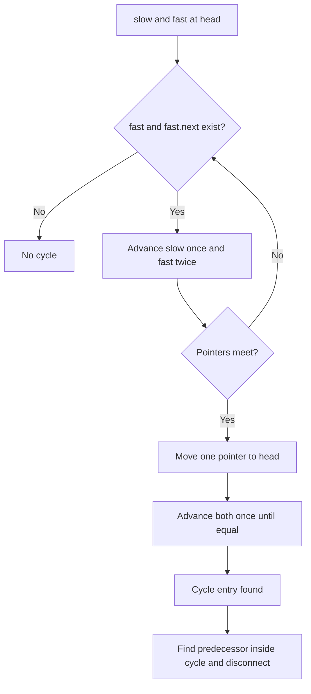

# Linked lists: CRUD, fast/slow pointers, reversal, merge sort

[← Preparation roadmap](README.md)

## Recognize the pattern

The input is connected by node references rather than contiguous positions. Solve pointer rewiring, cycle entry, middle detection, sorting, or shared-tail intersection.

## Problems already in this project

- [linked_list/crud_ll.py](../linked_list/crud_ll.py)
- [linked_list/loops_intersections.py](../linked_list/loops_intersections.py)
- [linked_list/ops_ll.py](../linked_list/ops_ll.py)

## Core idea and invariant

Reverse: prev is the already-reversed prefix; current begins the untouched suffix. Floyd: once slow and fast meet, moving one pointer from the head and one from the meeting point identifies the cycle entry.

## Example question

**Reversal question:** Reverse `1→2→3→null` without allocating replacement data nodes. Return the new head, node 3.

**Cycle question:** In `1→2→3→1`, find the cycle entry, then remove the cycle while preserving all three nodes.

## Detailed explanation and diagram

A node must remain reachable while its link is changed. Reversal saves `next` first, then points the current node backward, then advances. Losing the saved suffix would discard the unprocessed list.

```text
Before first rewrite:
prev=null       current=1 -> 2 -> 3 -> null
                              ^
                         saved next
After first rewrite:
null <- 1        2 -> 3 -> null
        prev     current
After final rewrite:
null <- 1 <- 2 <- 3
                  prev = returned head
```

Floyd's cycle-entry phase rests on a distance relation. Let μ be the length before the cycle, λ the cycle length, and x the meeting point's offset from the entry. At a meeting, the travel-distance difference is a multiple of λ, so `μ+x` is a multiple of λ. Thus advancing μ steps from both the head and meeting point reaches the entry. Once the entry is known, walking its cycle finds the actual predecessor, including when the entry is the head.

Intersection must compare identities: two distinct nodes both storing 7 are not an intersection. Merge sort applies a related fast/slow split but then uses divide and conquer.

## Algorithm

1. CRUD: handle head updates separately or return the new head; reject invalid positions.
2. Reverse: save next before changing current.next, then advance prev/current.
3. Cycle removal: detect the meeting, locate the entry, walk the cycle to its predecessor, and disconnect that predecessor.
4. Intersection: for acyclic lists, switch each pointer to the other head at the end; both traverse equal total distance.
5. Merge sort: find the left middle using slow/fast pointers, sever the list, recursively sort halves, and merge them iteratively.

## Flowchart



## Pseudocode

The pseudocode uses the same state and update rules as the Java methods. Separate variants are named explicitly.

```text
REVERSE(head):
    previous = null; current = head
    while current is not null:
        savedNext = current.next
        current.next = previous
        previous = current; current = savedNext
    return previous

CYCLE_ENTRY(head):
    advance slow once and fast twice until they meet or fast ends
    if fast ends: return null
    move slow to head
    advance both once until equal
    return their meeting node

REMOVE_CYCLE(head):
    entry = CYCLE_ENTRY(head)
    if entry is null: return false
    walk from entry until node.next == entry
    set that node.next = null
    return true
```

## Java implementation

This is a corrected Java study implementation derived from the linked project problems, rather than a verbatim copy of their bugs. Save the entire block as the public class name plus `.java` and compile with Java 17 or later. Methods are called from a driver or test; these classes do not require a `main` method to compile.

```java
public class LinkedLists {
    public static class Node {
        public int value; public Node next;
        public Node(int value) { this.value = value; }
    }
    public static Node append(Node head, int value) {
        Node added = new Node(value);
        if (head == null) return added;
        Node tail = head; while (tail.next != null) tail = tail.next;
        tail.next = added; return head;
    }
    public static Node insert(Node head, int index, int value) {
        if (index < 0) throw new IndexOutOfBoundsException();
        Node dummy = new Node(0); dummy.next = head; Node prev = dummy;
        for (int i = 0; i < index; i++) {
            if (prev.next == null) throw new IndexOutOfBoundsException();
            prev = prev.next;
        }
        Node added = new Node(value); added.next = prev.next; prev.next = added;
        return dummy.next;
    }
    public static void replace(Node head, int index, int value) {
        if (index < 0) throw new IndexOutOfBoundsException();
        Node node = head;
        for (int i = 0; i < index && node != null; i++) node = node.next;
        if (node == null) throw new IndexOutOfBoundsException();
        node.value = value;
    }
    public static Node deleteFirst(Node head, int value) {
        Node dummy = new Node(0); dummy.next = head; Node prev = dummy;
        while (prev.next != null && prev.next.value != value) prev = prev.next;
        if (prev.next != null) prev.next = prev.next.next;
        return dummy.next;
    }
    public static Node reverse(Node head) {
        Node prev = null;
        while (head != null) { Node next = head.next; head.next = prev; prev = head; head = next; }
        return prev;
    }
    public static Node cycleEntry(Node head) {
        Node slow = head, fast = head;
        while (fast != null && fast.next != null) {
            slow = slow.next; fast = fast.next.next;
            if (slow == fast) {
                slow = head;
                while (slow != fast) { slow = slow.next; fast = fast.next; }
                return slow;
            }
        }
        return null;
    }
    public static boolean removeCycle(Node head) {
        Node entry = cycleEntry(head);
        if (entry == null) return false;
        Node tail = entry; while (tail.next != entry) tail = tail.next;
        tail.next = null; return true;
    }
    public static Node intersection(Node a, Node b) {
        Node p = a, q = b;
        while (p != q) { p = p == null ? b : p.next; q = q == null ? a : q.next; }
        return p;
    }
    public static Node sort(Node head) {
        if (head == null || head.next == null) return head;
        Node slow = head, fast = head.next;
        while (fast != null && fast.next != null) { slow = slow.next; fast = fast.next.next; }
        Node right = slow.next; slow.next = null;
        return merge(sort(head), sort(right));
    }
    private static Node merge(Node a, Node b) {
        Node dummy = new Node(0), tail = dummy;
        while (a != null && b != null) {
            if (a.value <= b.value) { tail.next = a; a = a.next; }
            else { tail.next = b; b = b.next; }
            tail = tail.next;
        }
        tail.next = a != null ? a : b; return dummy.next;
    }
}
```

## Step-by-step dry run

### Reversal

| Step | previous before | current | saved next | Rewrite | previous / current afterward |
| --- | --- | --- | --- | --- | --- |
| 1 | null | 1 | 2 | `1.next=null` | 1 / 2 |
| 2 | 1 | 2 | 3 | `2.next=1` | 2 / 3 |
| 3 | 2 | 3 | null | `3.next=2` | 3 / null |
| 4 | 3 | null | — | Stop and return previous | Head is 3 |

### Head-entry cycle

For `1→2→3→1`, both pointers start at node 1:

| Iteration | slow after one step | fast after two | Equal? |
| --- | --- | --- | --- |
| 1 | 2 | 3 | No |
| 2 | 3 | 2 | No |
| 3 | 1 | 1 | Yes |

Reset slow to head; both are already node 1, so entry=1. The predecessor scan visits 1,2,3 and stops because `3.next==entry`. Setting `3.next=null` leaves the full acyclic list.

**Judge distinction:** locating the entry is read-only; removing the cycle is an extra operation not permitted by the Cycle II problem.

## Complexity

CRUD traversal O(n); reversal and cycle detection/removal O(n) time, O(1) space. Intersection O(m+n), O(1), assuming acyclic lists. Merge sort O(n log n) time with O(log n) recursive stack and iterative merging.

## Common mistakes and source differences

Compare node identity, not value, for intersections. Ordinary traversal/sorting assume no cycle. The source loop-removal shortcut loses nodes when a loop starts at the head; Java locates the true entry and predecessor. Always assign the returned head after insert/delete/reverse/sort.

## Related LeetCode practice

- [206. Reverse Linked List](https://leetcode.com/problems/reverse-linked-list/) — direct match to reverse.
- [142. Linked List Cycle II](https://leetcode.com/problems/linked-list-cycle-ii/) — return cycleEntry only; do not call removeCycle because the problem forbids modifying the list.
- [148. Sort List](https://leetcode.com/problems/sort-list/) — use merge sort; this recursive version has O(log n) stack space rather than the optional constant-space follow-up.

The official problem links above were checked on 10 November 2026. Descriptions here are summaries; follow each link for the judge’s complete constraints and API.

## Practice and recall

Test self-loop, head cycle, no cycle, empty list, shared tail, and distinct lists with equal values. Draw the before/after pointers for each write to next.
