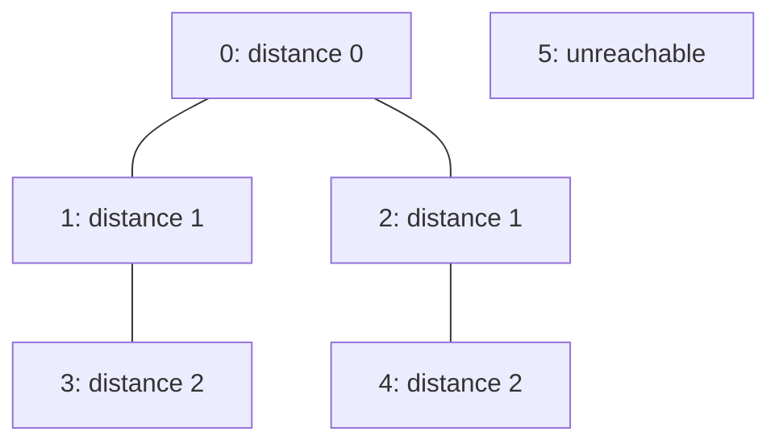
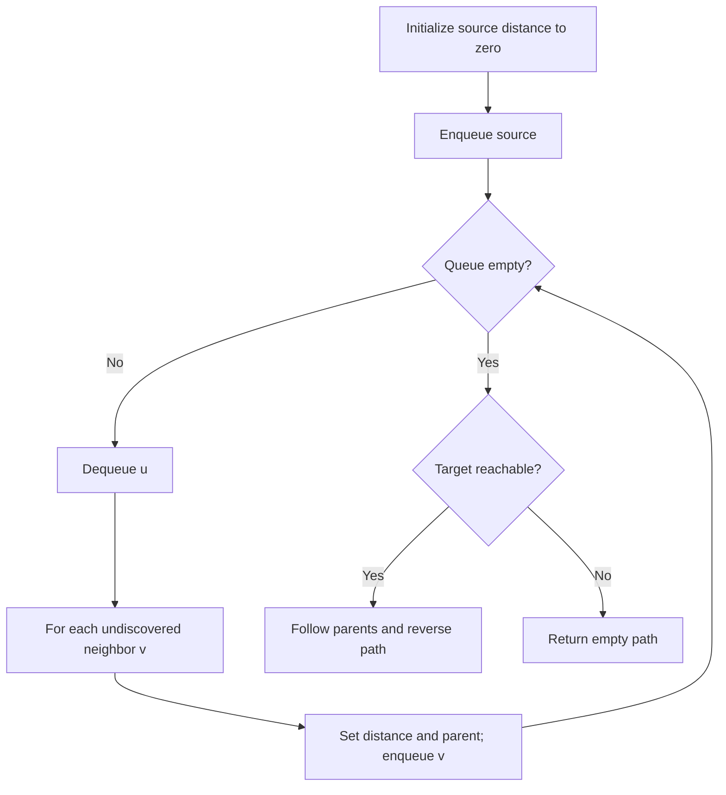

# Graph representation, BFS, DFS, and paths

[← Preparation roadmap](README.md)

## Recognize the pattern

Reachability, traversal order, components, or a shortest path in a graph with equal-cost edges. Vertices are numbered 0 through n−1.

## Problems already in this project

- [graphs/bfs.cpp](../graphs/bfs.cpp)
- [graphs/bfs.py](../graphs/bfs.py)
- [graphs/create_graph.cpp](../graphs/create_graph.cpp)
- [graphs/dfs.cpp](../graphs/dfs.cpp)
- [graphs/dfs.py](../graphs/dfs.py)
- [graphs/path.cpp](../graphs/path.cpp)

## Core idea and invariant

BFS explores increasing edge distance and marks on enqueue; dist[v] = dist[u] + 1. DFS explores a branch using recursion or an explicit stack. Parent pointers reconstruct a discovered path.

## Example question

An undirected graph has vertices 0..5 and edges `0–1, 0–2, 1–3, 2–4`; vertex 5 is isolated. Find a shortest path from 0 to 4 and report distances from 0.

**Expected path:** `[0,2,4]`

**Distances:** `[0,1,1,2,2,-1]`, where −1 means unreachable.

## Detailed explanation and diagram

BFS is a wavefront. All vertices first discovered from a distance-d vertex get distance d+1. Since every distance-d vertex is removed before any later wave is expanded, the first discovery cannot be improved by a shorter unprocessed route.



An adjacency list answers 'which neighbors exist?' directly. A matrix answers 'does this pair have an edge?' directly but must scan V entries to enumerate a row. Parent pointers store the edge that first discovered a vertex, forming a search tree. DFS instead fully explores one branch; its discovery path need not be shortest. Restarting DFS or BFS at an unseen vertex covers disconnected portions.

## Algorithm

1. Build an adjacency list; add both directions only for an undirected graph.
2. BFS: initialize distances and parents to −1, enqueue the source, and discover each unvisited neighbor once.
3. Reconstruct a path only if the target is reachable; follow parents backward and reverse.
4. DFS: process each unvisited vertex and recurse into unvisited neighbors. Restart at every unvisited vertex to cover a disconnected graph.
5. An adjacency matrix stores the same edges in n×n cells; BFS/DFS scan an entire row to enumerate neighbors.

## Flowchart



## Pseudocode

The pseudocode uses the same state and update rules as the Java methods. Separate variants are named explicitly.

```text
BFS(graph, source):
    fill distance and parent with -1
    distance[source] = 0; enqueue source
    while queue not empty:
        u = dequeue
        record u in traversal order
        for each neighbor v of u:
            if distance[v] == -1:
                distance[v] = distance[u] + 1
                parent[v] = u
                enqueue v

PATH(target):
    if distance[target] == -1: return empty list
    follow parent from target to -1 and reverse collected vertices

DFS_ALL(graph):
    for each vertex u:
        if unseen: recursively mark and visit all unseen neighbors
```

## Java implementation

This is a corrected Java study implementation derived from the linked project problems, rather than a verbatim copy of their bugs. Save the entire block as the public class name plus `.java` and compile with Java 17 or later. Methods are called from a driver or test; these classes do not require a `main` method to compile.

```java
import java.util.*;

public class GraphTraversal {
    public static List<List<Integer>> graph(int n, int[][] edges, boolean directed) {
        if (n < 0) throw new IllegalArgumentException();
        List<List<Integer>> g = new ArrayList<>();
        for (int i = 0; i < n; i++) g.add(new ArrayList<>());
        for (int[] edge : edges) {
            int u = edge[0], v = edge[1];
            g.get(u).add(v); if (!directed) g.get(v).add(u);
        }
        return g;
    }
    public static int[][] matrix(List<List<Integer>> g) {
        int[][] m = new int[g.size()][g.size()];
        for (int u = 0; u < g.size(); u++) for (int v : g.get(u)) m[u][v] = 1;
        return m;
    }
    public record Search(int[] distance, int[] parent, List<Integer> order) {}
    public static Search bfs(List<List<Integer>> g, int source) {
        Objects.checkIndex(source, g.size());
        int[] distance = new int[g.size()], parent = new int[g.size()];
        Arrays.fill(distance, -1); Arrays.fill(parent, -1);
        List<Integer> order = new ArrayList<>(); Deque<Integer> q = new ArrayDeque<>();
        distance[source] = 0; q.add(source);
        while (!q.isEmpty()) {
            int u = q.remove(); order.add(u);
            for (int v : g.get(u)) if (distance[v] == -1) {
                distance[v] = distance[u] + 1; parent[v] = u; q.add(v);
            }
        }
        return new Search(distance, parent, order);
    }
    public static List<Integer> shortestPath(List<List<Integer>> g, int source, int target) {
        Objects.checkIndex(target, g.size());
        Search result = bfs(g, source);
        List<Integer> path = new ArrayList<>();
        if (result.distance[target] == -1) return path;
        for (int v = target; v != -1; v = result.parent[v]) path.add(v);
        Collections.reverse(path); return path;
    }
    public static List<Integer> dfsAll(List<List<Integer>> g) {
        List<Integer> order = new ArrayList<>(); boolean[] seen = new boolean[g.size()];
        for (int u = 0; u < g.size(); u++) if (!seen[u]) visit(g, u, seen, order);
        return order;
    }
    private static void visit(List<List<Integer>> g, int u, boolean[] seen, List<Integer> order) {
        seen[u] = true; order.add(u);
        for (int v : g.get(u)) if (!seen[v]) visit(g, v, seen, order);
    }
}
```

## Step-by-step dry run

Neighbor insertion order is 1 before 2 for vertex 0. The queue is listed front → back.

| Step | Removed | Newly discovered | Queue afterward | Parent assignments |
| --- | --- | --- | --- | --- |
| 0 | — | 0 at distance 0 | `[0]` | parent[0]=−1 |
| 1 | 0 | 1,2 at distance 1 | `[1,2]` | parent[1]=0, parent[2]=0 |
| 2 | 1 | 3 at distance 2 | `[2,3]` | parent[3]=1 |
| 3 | 2 | 4 at distance 2 | `[3,4]` | parent[4]=2 |
| 4 | 3 | None; 1 already discovered | `[4]` | Unchanged |
| 5 | 4 | None; 2 already discovered | `[]` | Unchanged |

Reconstruct target 4 backward: `4 → parent[4]=2 → parent[2]=0 → −1`. Reverse `[4,2,0]` to get `[0,2,4]`.

Target 5 keeps distance −1; return an empty path without following parents. `dfsAll` additionally visits isolated vertex 5 after finishing the component containing 0.

## Complexity

Adjacency-list traversal: O(V+E) time, O(V) search state excluding graph/output. Representation: O(V+E) list storage versus O(V²) matrix storage and traversal time. Recursive DFS stack can reach O(V).

## Common mistakes and source differences

A dequeue counter is not a BFS level. Never reconstruct an unreachable target. The Java version avoids the source’s static DFS state and invalid iterative-DFS backtracking; BFS is the provided path routine. For very deep graphs use an explicit stack. A directed DFS forest is not a computation of strongly connected components.

## Related LeetCode practice

- [1971. Find if Path Exists in Graph](https://leetcode.com/problems/find-if-path-exists-in-graph/) — asks only whether a path exists. BFS reachability is enough; the guide additionally computes a shortest path and distances.

The official problem links above were checked on 10 November 2026. Descriptions here are summaries; follow each link for the judge’s complete constraints and API.

## Practice and recall

Trace the queue, parents, and distances. Explain why marking only at dequeue can enqueue duplicates. Compare BFS shortest paths with DFS reachability.
