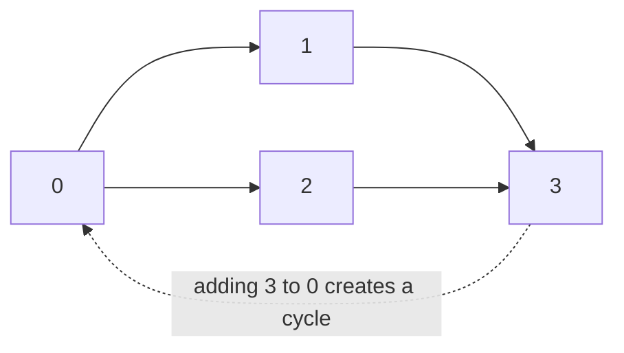
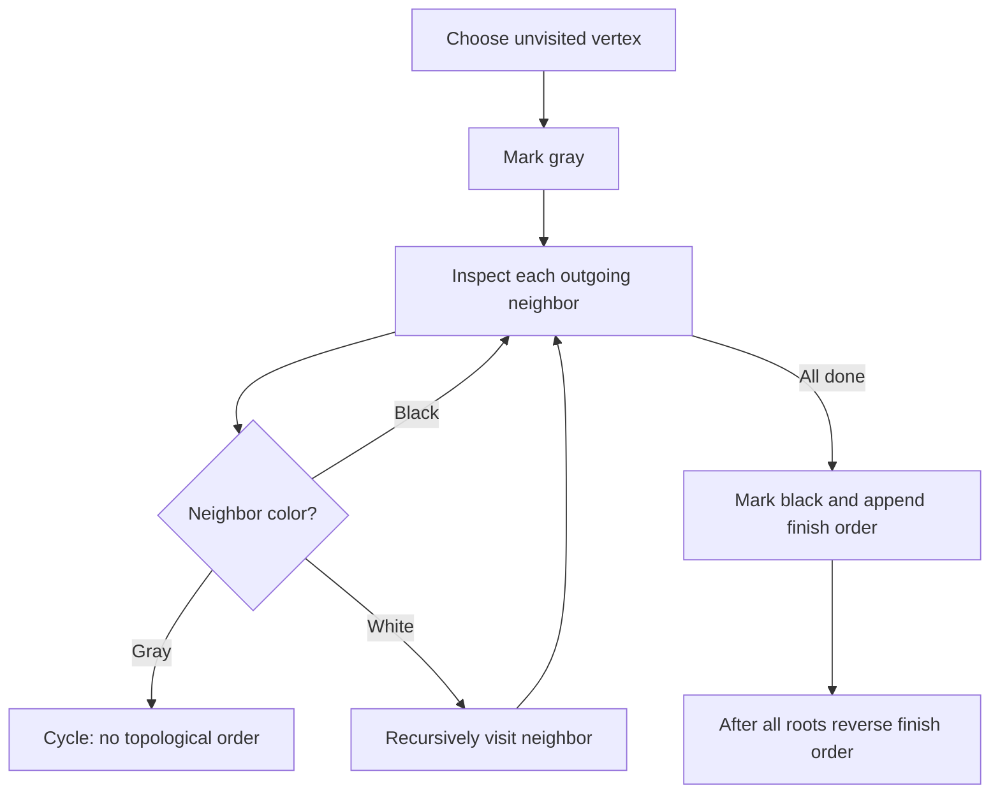

# Cycle detection and topological ordering

[← Preparation roadmap](README.md)

## Recognize the pattern

Dependencies require an order, or a graph must be checked for a cycle. Directed and undirected cycles require different tests.

## Problems already in this project

- [graphs/cycles.cpp](../graphs/cycles.cpp)
- [graphs/cycles.py](../graphs/cycles.py)
- [graphs/topo_sort.cpp](../graphs/topo_sort.cpp)

## Core idea and invariant

Directed DFS uses white=unvisited, gray=active, black=finished. An edge to gray is a back edge. Undirected DFS ignores the one edge back to the parent. DFS finishing order reversed is a topological order only when no directed cycle exists.

## Example question

Courses are vertices 0,1,2,3. Dependency edges are `0→1, 0→2, 1→3, 2→3`, where an arrow means the earlier course must be completed first. Produce one valid order, or reject the graph if it contains a directed cycle.

**One valid output using the listed adjacency order:** `[0,2,1,3]`.

## Detailed explanation and diagram

A boolean visited array cannot distinguish a completed dependency from one still waiting on the current recursion chain. Gray identifies unfinished calls; following an edge to gray means 'this task depends on an ancestor that is waiting for this task,' which is circular. An edge to black is safe because that vertex has already finished.



In a DAG, every outgoing neighbor finishes before the current vertex is appended. Therefore reversing finishing order puts each prerequisite before its dependent. This argument depends on rejecting gray back edges first. For undirected graphs the edge back to the parent is normal, which is why a different parent-aware condition is needed.

## Algorithm

1. For a directed graph, start DFS at each unvisited vertex; mark gray on entry and black on completion.
2. A gray neighbor proves a cycle; a black neighbor does not.
3. Append each vertex when it finishes, then reverse the finish list if no cycle was found.
4. For a simple undirected graph, carry the parent; a visited neighbor other than the parent proves a cycle.
5. Cover all vertices, including vertex 0 and isolated vertices.

## Flowchart



## Pseudocode

The pseudocode uses the same state and update rules as the Java methods. Separate variants are named explicitly.

```text
VISIT(u):
    color[u] = GRAY
    for each outgoing neighbor v:
        if color[v] == GRAY: report cycle
        if color[v] == WHITE: VISIT(v)
    color[u] = BLACK
    append u to finish list

TOPOLOGICAL_ORDER(graph):
    for u from 0 through V-1:
        if color[u] == WHITE: VISIT(u)
    if any cycle was reported: return failure
    return reverse(finish list)

UNDIRECTED_VISIT(u, parent):
    mark u seen
    recurse into unseen neighbors
    a seen neighbor different from parent indicates a cycle
    (this parent-vertex form assumes a simple graph)
```

## Java implementation

This is a corrected Java study implementation derived from the linked project problems, rather than a verbatim copy of their bugs. Save the entire block as the public class name plus `.java` and compile with Java 17 or later. Methods are called from a driver or test; these classes do not require a `main` method to compile.

```java
import java.util.*;

public class Dependencies {
    public static List<Integer> topological(List<List<Integer>> g) {
        int[] color = new int[g.size()]; List<Integer> finish = new ArrayList<>();
        for (int u = 0; u < g.size(); u++) if (color[u] == 0 && !visit(g, u, color, finish))
            throw new IllegalArgumentException("Directed cycle");
        Collections.reverse(finish); return finish;
    }
    private static boolean visit(List<List<Integer>> g, int u, int[] color, List<Integer> finish) {
        color[u] = 1;
        for (int v : g.get(u)) {
            if (color[v] == 1) return false;
            if (color[v] == 0 && !visit(g, v, color, finish)) return false;
        }
        color[u] = 2; finish.add(u); return true;
    }
    public static boolean directedCycle(List<List<Integer>> g) {
        try { topological(g); return false; }
        catch (IllegalArgumentException cycle) { return true; }
    }
    // Assumes a simple undirected graph represented by symmetric adjacency lists.
    public static boolean undirectedCycle(List<List<Integer>> g) {
        boolean[] seen = new boolean[g.size()];
        for (int u = 0; u < g.size(); u++) if (!seen[u] && undirected(g, u, -1, seen)) return true;
        return false;
    }
    private static boolean undirected(List<List<Integer>> g, int u, int parent, boolean[] seen) {
        seen[u] = true;
        for (int v : g.get(u)) {
            if (!seen[v]) { if (undirected(g, v, u, seen)) return true; }
            else if (v != parent) return true;
        }
        return false;
    }
}
```

## Step-by-step dry run

| Step | DFS event | Gray / active chain | Finish list |
| --- | --- | --- | --- |
| 1 | Enter 0 | `0` | `[]` |
| 2 | Follow 0→1 | `0,1` | `[]` |
| 3 | Follow 1→3 | `0,1,3` | `[]` |
| 4 | Finish 3; mark black | `0,1` | `[3]` |
| 5 | Finish 1 | `0` | `[3,1]` |
| 6 | Follow 0→2 | `0,2` | `[3,1]` |
| 7 | Inspect 2→3; 3 is black, so skip safely | `0,2` | `[3,1]` |
| 8 | Finish 2 | `0` | `[3,1,2]` |
| 9 | Finish 0 | Empty | `[3,1,2,0]` |
| 10 | Reverse finish list | — | `[0,2,1,3]` |

**Cycle counterexample:** adding 3→0 encounters gray 0 while active chain is `0,1,3`; abort rather than presenting a false ordering. Validate the successful order by checking that every arrow points from a smaller output position to a larger one.

## Complexity

O(V+E) time and O(V) state/stack for list representation. The returned ordering contains V vertices.

## Common mistakes and source differences

The original topological loops skip vertex 0 and do not reject cycles. The Java conversion corrects both. Parent-vertex skipping assumes no parallel undirected edges; multigraphs need edge identities. A topological order need not be unique.

## Related LeetCode practice

- [207. Course Schedule](https://leetcode.com/problems/course-schedule/) — return whether directedCycle is false. Convert prerequisite pair [course, prerequisite] into prerequisite→course.
- [210. Course Schedule II](https://leetcode.com/problems/course-schedule-ii/) — return a topological order or an empty array on a cycle; adapt the guide’s exception-based failure API.

The official problem links above were checked on 10 November 2026. Descriptions here are summaries; follow each link for the judge’s complete constraints and API.

## Practice and recall

Validate an order by checking that every edge points from an earlier position to a later one. Test self-loops, cross edges, disconnected components, and a directed cycle.
