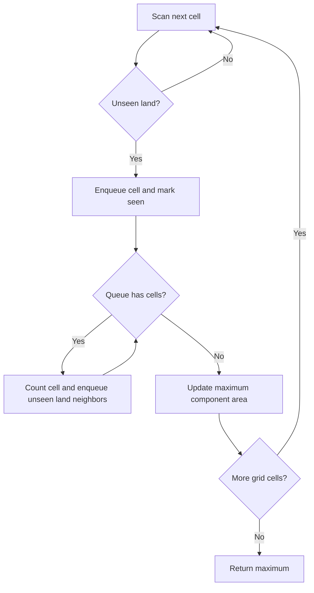

# Grid traversal: flood fill and shortest knight moves

[← Preparation roadmap](README.md)

## Recognize the pattern

Treat a cell as a graph vertex and legal moves as edges. Use flood fill for connected area; use BFS for fewest equal-cost moves.

## Problems already in this project

- [graphs/largest_island_dfs_grid.cpp](../graphs/largest_island_dfs_grid.cpp)
- [graphs/minimum_moves_knight_bfs_grid.py](../graphs/minimum_moves_knight_bfs_grid.py)

## Core idea and invariant

A cell is marked seen when enqueued, so each reachable cell contributes once. Neighbors differ by a problem-specific move array.

## Example question

Find the area of the largest existing four-directionally connected island in:

```text
1 1 0
0 1 0
0 0 1
```

**Output:** `3`. Diagonal contact does not connect the last cell to the first island. No water cell may be flipped in this question.

## Detailed explanation and diagram

A grid is an implicit graph: cell (r,c) is a vertex and legal coordinate changes are edges. There is no need to materialize every adjacency list. When flood fill discovers land, mark it immediately so another frontier cell cannot enqueue it again. A persistent visited matrix ensures the outer scan skips the rest of that component.

```text
Raw cells                 Component labels
1 1 0                     A A .
0 1 0          ->         . A .
0 0 1                     . . B

A has area 3; B has area 1.
```

For an unweighted shortest route, replace area counting with distance layers. The knight version uses eight move offsets and the same discovery-on-enqueue rule. A tour is a different objective: it must visit every square without reuse, so it needs the backtracking state in that guide.

## Algorithm

1. Largest island: scan all cells. At each unseen land cell, flood-fill its four-directional component and count cells; keep the maximum area.
2. Knight distance: initialize a BFS from the start on an 8×8 board with coordinates 1 through 8, matching the source convention.
3. Enqueue valid unseen knight destinations with distance+1. The first time the target is dequeued is optimal.
4. Keep grid coordinates separate from array bounds; support empty and rectangular island grids.

## Flowchart



## Pseudocode

The pseudocode uses the same state and update rules as the Java methods. Separate variants are named explicitly.

```text
LARGEST_ISLAND(grid):
    seen = false for all cells; best = 0
    for each cell:
        if water or seen: continue
        enqueue cell; mark seen; area = 0
        while queue not empty:
            current = dequeue; area = area + 1
            for each of four neighboring coordinates:
                if in bounds, land, and unseen:
                    mark seen; enqueue neighbor
        best = max(best, area)
    return best

KNIGHT_DISTANCE(start, target):
    BFS using eight knight offsets, carrying distance
    return distance when target is removed from queue
    return -1 if queue empties without target
```

## Java implementation

This is a corrected Java study implementation derived from the linked project problems, rather than a verbatim copy of their bugs. Save the entire block as the public class name plus `.java` and compile with Java 17 or later. Methods are called from a driver or test; these classes do not require a `main` method to compile.

```java
import java.util.*;

public class GridTraversal {
    public static int largestIsland(int[][] grid) {
        int rows = grid.length;
        if (rows == 0) return 0;
        int cols = grid[0].length;
        for (int[] row : grid) if (row.length != cols) throw new IllegalArgumentException("Ragged grid");
        boolean[][] seen = new boolean[rows][cols];
        int[][] moves = {{-1,0},{1,0},{0,-1},{0,1}};
        int best = 0;
        for (int r = 0; r < rows; r++) for (int c = 0; c < cols; c++) {
            if (grid[r][c] != 1 || seen[r][c]) continue;
            Deque<int[]> q = new ArrayDeque<>(); q.add(new int[]{r,c}); seen[r][c] = true;
            int area = 0;
            while (!q.isEmpty()) {
                int[] cell = q.remove(); area++;
                for (int[] move : moves) {
                    int nr = cell[0] + move[0], nc = cell[1] + move[1];
                    if (nr >= 0 && nr < rows && nc >= 0 && nc < cols && grid[nr][nc] == 1 && !seen[nr][nc]) {
                        seen[nr][nc] = true; q.add(new int[]{nr,nc});
                    }
                }
            }
            best = Math.max(best, area);
        }
        return best;
    }
    public static int knightDistance(int sx, int sy, int tx, int ty) {
        if (!inside(sx,sy) || !inside(tx,ty)) throw new IllegalArgumentException("Coordinates must be 1..8");
        int[][] moves = {{-2,-1},{-2,1},{-1,-2},{-1,2},{1,-2},{1,2},{2,-1},{2,1}};
        boolean[][] seen = new boolean[9][9];
        Deque<int[]> q = new ArrayDeque<>(); q.add(new int[]{sx,sy,0}); seen[sx][sy] = true;
        while (!q.isEmpty()) {
            int[] cell = q.remove();
            if (cell[0] == tx && cell[1] == ty) return cell[2];
            for (int[] move : moves) {
                int x = cell[0] + move[0], y = cell[1] + move[1];
                if (inside(x,y) && !seen[x][y]) { seen[x][y] = true; q.add(new int[]{x,y,cell[2]+1}); }
            }
        }
        return -1;
    }
    private static boolean inside(int x, int y) { return x >= 1 && x <= 8 && y >= 1 && y <= 8; }
}
```

## Step-by-step dry run

The move order in Java is up, down, left, right.

| Step | Action | Queue afterward | Current area |
| --- | --- | --- | --- |
| 1 | Outer scan finds (0,0); mark/enqueue | `[(0,0)]` | 0 |
| 2 | Remove (0,0); only (0,1) is unseen adjacent land | `[(0,1)]` | 1 |
| 3 | Remove (0,1); discover (1,1) | `[(1,1)]` | 2 |
| 4 | Remove (1,1); all valid adjacent land already seen | `[]` | 3 |
| 5 | Store best=3; outer scan skips these seen cells | `[]` | — |
| 6 | Scan reaches (2,2); start another component | `[(2,2)]` | 0 |
| 7 | Remove (2,2); no four-direction land neighbors | `[]` | 1 |
| 8 | best=max(3,1); return 3 | `[]` | — |

**Knight mini-trace:** start (1,1), target (2,3). Initially queue `[(1,1,0)]`; expanding the start discovers (2,3) with distance 1. The first removal of that target returns 1. Start=target returns 0 before expanding any move.

## Complexity

Island flood fill: O(rows×cols) time and space, without changing the input grid. Knight BFS: O(B²) time and space for a B×B board; here B is the fixed constant 8.

## Common mistakes and source differences

The island source shadows its dimension with an uninitialized variable and clears visited after each cell. Java uses a persistent seen matrix and iterative flood fill. Largest island here means largest existing component, not the different problem of flipping one water cell.

## Related LeetCode practice

- [695. Max Area of Island](https://leetcode.com/problems/max-area-of-island/) — direct match to the existing-island question and largestIsland implementation.

The official problem links above were checked on 10 November 2026. Descriptions here are summaries; follow each link for the judge’s complete constraints and API.

## Practice and recall

Change only the move array to model diagonal adjacency. Explain why a knight’s tour needs backtracking while minimum knight moves needs BFS.
