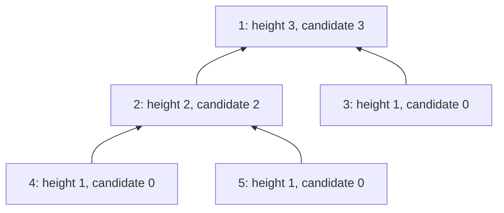
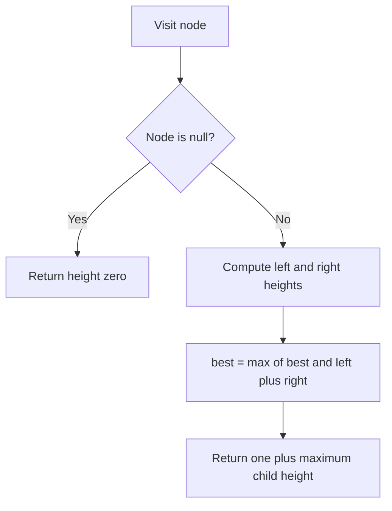

# Tree recursion: aggregates, structure, paths, LCA, diameter

[← Preparation roadmap](README.md)

## Recognize the pattern

The answer for a tree can be expressed using its child subtrees, or you need to carry a path from root to a node. Level-order grouping uses a queue instead.

## Problems already in this project

- [trees/01_Recursion/basic_tree_recusion.cpp](../trees/01_Recursion/basic_tree_recusion.cpp)
- [trees/01_Recursion/trees_recursion.py](../trees/01_Recursion/trees_recursion.py)
- [trees/01_Recursion/types_of_trees.cpp](../trees/01_Recursion/types_of_trees.cpp)
- [trees/diameter.py](../trees/diameter.py)
- [trees/lca.py](../trees/lca.py)
- [trees/root_to_leaf_path.py](../trees/root_to_leaf_path.py)
- [trees/root_to_node_path.py](../trees/root_to_node_path.py)
- [trees/trees.py](../trees/trees.py)

## Core idea and invariant

Give each recursive helper a clear contract. Height counts nodes; diameter below counts edges. For paths, restore the mutable path on exit. For maximum, the empty subtree contributes negative infinity.

## Example question

Given the tree below, compute its diameter in **edges**, and explain how the same recursion also returns subtree heights in **nodes**.

```text
        1
       / \
      2   3
     / \
    4   5
```

**Output:** diameter 3, for path `4→2→1→3` or `5→2→1→3`.

## Detailed explanation and diagram

Each helper invocation returns only the longest downward height from its own node. It separately updates a best diameter shared by the traversal. Those quantities differ: a parent can extend only one child branch, while a path whose highest point is the current node can combine both branches.

Every simple tree path has a unique highest node. Evaluating `leftHeight+rightHeight` at **every** node therefore considers the true longest path, even when it lies entirely below the root. If a child subtree has height h nodes, the branch from its parent down to its deepest leaf uses h edges; this explains why adding the child node-heights directly gives edge diameter.



Other tree patterns change the return contract: sum returns a total, maximum uses negative infinity for null, and LCA returns a matching node or a split ancestor. Path enumeration instead carries a mutable root-to-current list and must undo it on return.

## Algorithm

1. Aggregates: return a neutral result for null, then combine node value and child results.
2. Diameter: return height and update the best leftHeight+rightHeight at every node, including nodes below the root.
3. Root paths: push the current node; copy at a leaf/target; pop before returning.
4. LCA: recurse into both children; two matches identify their common ancestor. This version checks that both requested node identities exist.
5. Full: zero or two children. Perfect: equal subtree heights and both perfect. Complete: after the first missing child in BFS, no later child may exist. Skewed: at most one child per node.

## Flowchart



## Pseudocode

The pseudocode uses the same state and update rules as the Java methods. Separate variants are named explicitly.

```text
DIAMETER(root):
    best = 0
    HEIGHT(node):
        if node is null: return 0
        left = HEIGHT(node.left)
        right = HEIGHT(node.right)
        best = max(best, left + right)
        return 1 + max(left, right)
    HEIGHT(root)
    return best

ROOT_TO_LEAF(node, path):
    if node is null: return
    append node value to path
    if leaf: record a copy of path
    otherwise recurse into both children
    remove final value from path

LCA_KNOWN_PRESENT(node, a, b):
    return node if null or equal to a or b
    solve both children
    return node if both answers are non-null, otherwise the non-null answer
```

## Java implementation

This is a corrected Java study implementation derived from the linked project problems, rather than a verbatim copy of their bugs. Save the entire block as the public class name plus `.java` and compile with Java 17 or later. Methods are called from a driver or test; these classes do not require a `main` method to compile.

```java
import java.util.*;

public class TreePatterns {
    public static class Node {
        public int value; public Node left, right;
        public Node(int value) { this.value = value; }
    }
    public static long sum(Node n) { return n == null ? 0 : n.value + sum(n.left) + sum(n.right); }
    public static int count(Node n) { return n == null ? 0 : 1 + count(n.left) + count(n.right); }
    public static int height(Node n) { return n == null ? 0 : 1 + Math.max(height(n.left), height(n.right)); }
    public static int maximum(Node n) { return n == null ? Integer.MIN_VALUE : Math.max(n.value, Math.max(maximum(n.left), maximum(n.right))); }
    public static boolean contains(Node n, int value) { return n != null && (n.value == value || contains(n.left,value) || contains(n.right,value)); }
    public static List<Integer> traversal(Node root, int mode) {
        if (mode < 0 || mode > 2) throw new IllegalArgumentException("0 preorder, 1 inorder, 2 postorder");
        List<Integer> out = new ArrayList<>(); traverse(root,mode,out); return out;
    }
    private static void traverse(Node n, int mode, List<Integer> out) {
        if (n == null) return;
        if (mode == 0) out.add(n.value); traverse(n.left,mode,out);
        if (mode == 1) out.add(n.value); traverse(n.right,mode,out);
        if (mode == 2) out.add(n.value);
    }
    public static int diameter(Node root) { int[] best = {0}; diameterHeight(root,best); return best[0]; }
    private static int diameterHeight(Node n, int[] best) {
        if (n == null) return 0;
        int left = diameterHeight(n.left,best), right = diameterHeight(n.right,best);
        best[0] = Math.max(best[0], left + right); return 1 + Math.max(left,right);
    }
    public static List<List<Integer>> leafPaths(Node root) {
        List<List<Integer>> out = new ArrayList<>(); paths(root,new ArrayList<>(),out); return out;
    }
    private static void paths(Node n, List<Integer> path, List<List<Integer>> out) {
        if (n == null) return;
        path.add(n.value);
        if (n.left == null && n.right == null) out.add(new ArrayList<>(path));
        else { paths(n.left,path,out); paths(n.right,path,out); }
        path.remove(path.size()-1);
    }
    public static List<Integer> pathTo(Node root, Node target) {
        List<Integer> path = new ArrayList<>(); findPath(root,target,path); return path;
    }
    private static boolean findPath(Node n, Node target, List<Integer> path) {
        if (n == null) return false;
        path.add(n.value);
        if (n == target || findPath(n.left,target,path) || findPath(n.right,target,path)) return true;
        path.remove(path.size()-1); return false;
    }
    public static Node lca(Node root, Node a, Node b) {
        if (a == null || b == null || !exists(root,a) || !exists(root,b)) return null;
        return lcaKnown(root,a,b);
    }
    private static boolean exists(Node n, Node target) { return n != null && (n == target || exists(n.left,target) || exists(n.right,target)); }
    private static Node lcaKnown(Node n, Node a, Node b) {
        if (n == null || n == a || n == b) return n;
        Node left = lcaKnown(n.left,a,b), right = lcaKnown(n.right,a,b);
        return left != null && right != null ? n : left != null ? left : right;
    }
    public static boolean full(Node n) {
        if (n == null || (n.left == null && n.right == null)) return true;
        return n.left != null && n.right != null && full(n.left) && full(n.right);
    }
    public static boolean skewed(Node n) {
        return n == null || ((n.left == null || n.right == null) && skewed(n.left) && skewed(n.right));
    }
    public static boolean perfect(Node root) { return perfectHeight(root) >= 0; }
    private static int perfectHeight(Node n) {
        if (n == null) return 0;
        int l = perfectHeight(n.left), r = perfectHeight(n.right);
        return l < 0 || r < 0 || l != r ? -1 : l + 1;
    }
    public static boolean complete(Node root) {
        if (root == null) return true;
        Deque<Node> q = new ArrayDeque<>(); q.add(root); boolean gap = false;
        while (!q.isEmpty()) {
            Node n = q.remove();
            for (Node child : new Node[]{n.left,n.right}) {
                if (child == null) gap = true;
                else { if (gap) return false; q.add(child); }
            }
        }
        return true;
    }
    public static List<List<Integer>> levels(Node root) {
        List<List<Integer>> out = new ArrayList<>();
        if (root == null) return out;
        Deque<Node> q = new ArrayDeque<>(); q.add(root);
        while (!q.isEmpty()) {
            int size = q.size(); List<Integer> level = new ArrayList<>();
            while (size-- > 0) {
                Node n = q.remove(); level.add(n.value);
                if (n.left != null) q.add(n.left); if (n.right != null) q.add(n.right);
            }
            out.add(level);
        }
        return out;
    }
}
```

## Step-by-step dry run

Postorder means a parent's row is processed after its children.

| Node | Left height | Right height | Candidate diameter | Global best after | Returned height |
| --- | --- | --- | --- | --- | --- |
| 4 | 0 | 0 | 0 | 0 | 1 |
| 5 | 0 | 0 | 0 | 0 | 1 |
| 2 | 1 | 1 | 2 | 2 | 2 |
| 3 | 0 | 0 | 0 | 2 | 1 |
| 1 | 2 | 1 | 3 | 3 | 3 |

### Path-state mini-trace

For root-to-leaf enumeration, push 1 → `[1]`; push 2 → `[1,2]`; push 4 → `[1,2,4]`; copy that leaf path; pop 4 → `[1,2]`; push 5 → `[1,2,5]`. Without the pop, the second answer would incorrectly include 4.

### LCA mini-trace

For node identities 4 and 5, the left/right recursive answers at node 2 are both non-null, so node 2 is returned. At node 1, only its left subtree has an answer, so it propagates 2. The public Java method first verifies both requested identities exist.

## Complexity

Aggregates, diameter, structure checks, traversals, and LCA: O(n) time, O(h) recursive stack except completeness/levels use O(width) queue space. Output storage is additional. Leaf-path enumeration costs O(n + total output path length); it can be O(n²). pathTo uses O(h) path storage plus stack.

## Common mistakes and source differences

The source diameter checks only paths through the root and counts nodes. Java checks every node and counts edges. Empty-tree maximum returns Integer.MIN_VALUE as a documented sentinel. LCA takes node identities, avoiding duplicate-value ambiguity. Recursive methods can exhaust the Java stack on a very deep tree.

## Related LeetCode practice

- [543. Diameter of Binary Tree](https://leetcode.com/problems/diameter-of-binary-tree/) — direct match; count edges, not nodes.
- [236. Lowest Common Ancestor of a Binary Tree](https://leetcode.com/problems/lowest-common-ancestor-of-a-binary-tree/) — same identity-based recursion; this problem guarantees the requested nodes exist.

The official problem links above were checked on 10 November 2026. Descriptions here are summaries; follow each link for the judge’s complete constraints and API.

## Practice and recall

Construct a tree whose diameter is entirely inside one child subtree. Distinguish full, complete, and perfect using counterexamples. Draw recursion return values rather than only traversal order.
