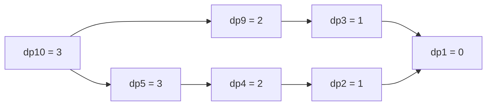
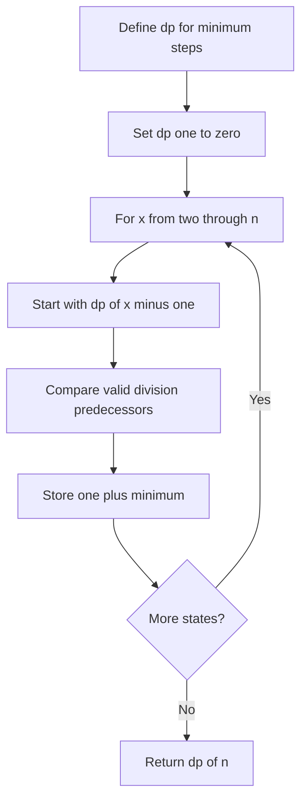

# DP foundations: linear states and memoization

[← Preparation roadmap](README.md)

## Recognize the pattern

A recursion revisits the same state, and future work depends only on that state. Ask whether the result is a minimum, maximum, feasibility value, or count.

## Problems already in this project

- [dynamic-programming/01_Fibonacci/fib.cpp](../dynamic-programming/01_Fibonacci/fib.cpp)
- [dynamic-programming/01_Fibonacci/fib_memo.cpp](../dynamic-programming/01_Fibonacci/fib_memo.cpp)
- [dynamic-programming/Problem_Set_Easy/01_min_steps_to_one.cpp](../dynamic-programming/Problem_Set_Easy/01_min_steps_to_one.cpp)

## Core idea and invariant

Write the state meaning before the recurrence. Memoization caches on demand; tabulation processes dependencies before the current state. The project Fibonacci uses f(0)=f(1)=1, a shifted sequence counting staircase paths.

## Example question

**Minimum-steps question:** Start with n=10. In one step, subtract one, divide by two when divisible, or divide by three when divisible. Reach 1 in as few steps as possible.

**Output:** `3`, using `10→9→3→1`.

**Counting variant:** How many ways can 5 stairs be climbed using steps of 1 or 2? Expected count: `8`.

## Detailed explanation and diagram

The state `dp[x]` must answer the same question for every x: minimum remaining operations from x to 1. Every valid first move leads to a smaller state, and each move costs one. Taking the minimum over those predecessor answers is exhaustive, not a heuristic. Filling x in ascending order guarantees all dependencies are ready.



The diagram labels are costs **from each state**, not distances from 10. From 10, taking the division shortcut to 5 still leaves three more operations; choosing 9 leaves only two. This is why always dividing greedily fails.

For stair counting, partition solutions by their final move. A final 1-step comes from n−1; a final 2-step comes from n−2. These disjoint groups add. The empty staircase has one way (do nothing), yielding f(0)=f(1)=1.

## Algorithm

1. Shifted Fibonacci: f(n)=f(n−1)+f(n−2), with f(0)=f(1)=1.
2. Memoization: return base values, then check/cache f(n). Allocate cache per call.
3. Tabulation: only two previous states are required, giving O(1) storage.
4. Minimum steps: dp[1]=0; dp[x]=1+min(dp[x−1], dp[x/2] if divisible by 2, dp[x/3] if divisible by 3).
5. Subtracting one is always allowed; do not greedily divide whenever possible.

## Flowchart



## Pseudocode

The pseudocode uses the same state and update rules as the Java methods. Separate variants are named explicitly.

```text
MIN_STEPS(n):
    require n >= 1
    dp[1] = 0
    for x from 2 through n:
        best = dp[x-1]
        if x divisible by 2: best = min(best, dp[x/2])
        if x divisible by 3: best = min(best, dp[x/3])
        dp[x] = best + 1
    return dp[n]

STAIR_WAYS(n):
    previous = 1; current = 1
    for x from 2 through n:
        next = previous + current
        previous = current; current = next
    return current
```

## Java implementation

This is a corrected Java study implementation derived from the linked project problems, rather than a verbatim copy of their bugs. Save the entire block as the public class name plus `.java` and compile with Java 17 or later. Methods are called from a driver or test; these classes do not require a `main` method to compile.

```java
import java.util.*;

public class LinearDP {
    private static void fibonacciRange(int n) {
        if (n < 0 || n > 91) throw new IllegalArgumentException("Exact long result requires 0..91");
    }
    public static long fibMemo(int n) {
        fibonacciRange(n);
        long[] memo = new long[n + 1]; Arrays.fill(memo,-1); return fib(n,memo);
    }
    private static long fib(int n, long[] memo) {
        if (n <= 1) return 1;
        if (memo[n] != -1) return memo[n];
        return memo[n] = fib(n-1,memo) + fib(n-2,memo);
    }
    public static long fibTabulated(int n) {
        fibonacciRange(n);
        long previous = 1, current = 1;
        for (int i = 2; i <= n; i++) { long next = previous + current; previous = current; current = next; }
        return current;
    }
    public static int minStepsToOne(int n) {
        if (n < 1) throw new IllegalArgumentException("Positive n required");
        int[] dp = new int[n + 1];
        for (int x = 2; x <= n; x++) {
            dp[x] = dp[x-1] + 1;
            if (x % 2 == 0) dp[x] = Math.min(dp[x],dp[x/2]+1);
            if (x % 3 == 0) dp[x] = Math.min(dp[x],dp[x/3]+1);
        }
        return dp[n];
    }
}
```

## Step-by-step dry run

### Minimum steps

The candidate values below already include the one move just taken.

| x | Subtract candidate | Divide by 2 | Divide by 3 | dp[x] |
| --- | --- | --- | --- | --- |
| 1 | Base | — | — | 0 |
| 2 | dp[1]+1=1 | dp[1]+1=1 | — | 1 |
| 3 | dp[2]+1=2 | — | dp[1]+1=1 | 1 |
| 4 | dp[3]+1=2 | dp[2]+1=2 | — | 2 |
| 5 | dp[4]+1=3 | — | — | 3 |
| 6 | dp[5]+1=4 | dp[3]+1=2 | dp[2]+1=2 | 2 |
| 7 | dp[6]+1=3 | — | — | 3 |
| 8 | dp[7]+1=4 | dp[4]+1=3 | — | 3 |
| 9 | dp[8]+1=4 | — | dp[3]+1=2 | 2 |
| 10 | dp[9]+1=3 | dp[5]+1=4 | — | 3 |

Reading the best predecessors backward gives 10→9→3→1. The implementation returns the count; retaining an extra predecessor array would also return that path.

### Stair counting

| n | f[n−1] | f[n−2] | f[n] |
| --- | --- | --- | --- |
| 0 | — | — | 1, empty choice |
| 1 | — | — | 1 |
| 2 | 1 | 1 | 2 |
| 3 | 2 | 1 | 3 |
| 4 | 3 | 2 | 5 |
| 5 | 5 | 3 | 8 |

## Complexity

Fibonacci memoization: O(n) time and O(n) cache/stack; two-variable version O(n) time and O(1) space. Minimum steps: O(n) time, O(n) space. Naive Fibonacci in the project is exponential O(φ^n), not DP until caching is added.

## Common mistakes and source differences

Conventional Fibonacci starts 0,1; do not silently change the project’s convention. Signed long overflows the shifted sequence at n=92. Tabulation avoids the minimum-steps source’s potentially linear-depth recursion.

## Related LeetCode practice

- [70. Climbing Stairs](https://leetcode.com/problems/climbing-stairs/) — matches the guide’s shifted Fibonacci recurrence; conventional Fibonacci F(0)=0 is a different indexing convention.

The official problem links above were checked on 10 November 2026. Descriptions here are summaries; follow each link for the judge’s complete constraints and API.

## Practice and recall

For every DP problem write: state, base cases, transition, dependency order, and final answer. Continue to [knapsack](13_knapsack.md) and [LCS](14_lcs_scs.md).
