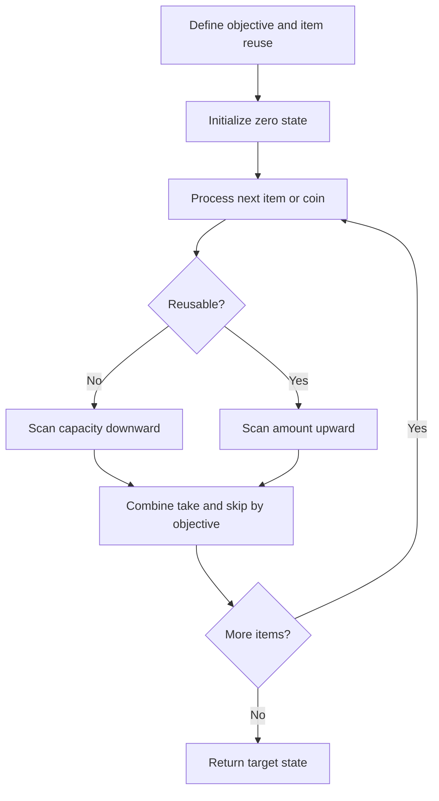

# Knapsack family: 0/1, subsets, coin change, target sum

[← Preparation roadmap](README.md)

## Recognize the pattern

Choose or skip items under a capacity/sum constraint. First ask: may an item be reused? Is the answer a maximum value, feasibility, minimum number, or count?

## Problems already in this project

- [dynamic-programming/02_Knapsack/LC_322.cpp](../dynamic-programming/02_Knapsack/LC_322.cpp)
- [dynamic-programming/02_Knapsack/LC_416.cpp](../dynamic-programming/02_Knapsack/LC_416.cpp)
- [dynamic-programming/02_Knapsack/LC_494.cpp](../dynamic-programming/02_Knapsack/LC_494.cpp)
- [dynamic-programming/02_Knapsack/LC_518.cpp](../dynamic-programming/02_Knapsack/LC_518.cpp)
- [dynamic-programming/02_Knapsack/knapsack.cpp](../dynamic-programming/02_Knapsack/knapsack.cpp)
- [dynamic-programming/02_Knapsack/knapsack_space_optimize.cpp](../dynamic-programming/02_Knapsack/knapsack_space_optimize.cpp)
- [dynamic-programming/02_Knapsack/subset_sum.cpp](../dynamic-programming/02_Knapsack/subset_sum.cpp)

## Core idea and invariant

For 0/1 DP, descending capacities preserve the previous item layer. For unbounded DP, ascending amounts allow the current coin to be reused. Counting combinations requires processing coin types outside the amount loop.

## Example question

**0/1 optimization:** Weights `[1,3,4,5]`, values `[1,4,5,7]`, capacity 7; each item is available once. Expected maximum value: `9`.

**Unbounded counting:** Coins `[1,2,5]`, amount 5; count combinations, not different orders. Expected count: `4`.

**Feasibility/sign variants:** Can `[1,5,11,5]` be equally partitioned? Yes. How many sign assignments of `[0,0,1]` give target 1? Four.

## Detailed explanation and diagram

A two-dimensional formulation stores an answer for each item prefix and capacity. Both 0/1 branches refer to the **previous** prefix: skipping retains capacity, taking consumes capacity. Compressing away the prefix dimension is safe only if a read still refers to the old layer.

```text
0/1 item (weight=3,value=4), capacity=7:
  skip -> best using earlier items at capacity 7
  take -> 4 + best using earlier items at capacity 4

Compressed table:
  descending: read lower capacity before current item updates it -> use once
  ascending:  lower capacity may already include current item    -> reuse allowed
```

The aggregation operator encodes the objective: max for profit, OR for feasibility, min for coin count, and addition for number of choices. The zero-sum base is true for feasibility and one for counting: the empty selection is a valid way to make zero.

For combinations, the outer coin loop means all ways have a canonical nondecreasing coin-type order. An amount-first counting loop instead considers different final coins and counts ordered sequences. For target sum, partition indices into plus-set P and minus-set N: P−N=target, P+N=total, so P=(total+target)/2. This reduction requires non-negative values.

## Algorithm

| Problem | State / transition | Loop direction |
| --- | --- | --- |
| 0/1 maximum value | dp[w] = max(dp[w], value+dp[w−weight]) | capacity descending |
| Subset feasibility | possible[s] |= possible[s−x] | sum descending |
| Equal partition | subset target = total/2 if total even | sum descending |
| Minimum coins | dp[a] = min(dp[a],1+dp[a−coin]) | amount increasing |
| Coin combinations | ways[a] += ways[a−coin] | coins outside, amount increasing |
| Target sum | plusSum=(total+target)/2; count subsets | sum descending |

1. Initialize feasibility/count at zero to true/one. For minimum coins use dp[0]=0 and unreachable sentinels elsewhere.
2. Apply the appropriate transition once per valid state.
3. Target sum assumes non-negative input: reject impossible magnitude or odd total+target before counting. Zero items double subset counts naturally.
4. Coin types must be positive and distinct. Java validates these assumptions. Counts use BigInteger to avoid silent overflow.

## Flowchart



## Pseudocode

The pseudocode uses the same state and update rules as the Java methods. Separate variants are named explicitly.

```text
ZERO_ONE_MAX(items, capacity):
    dp[0..capacity] = 0
    for each (weight, value):
        for w from capacity down to weight:
            dp[w] = max(dp[w], value + dp[w-weight])
    return dp[capacity]

SUBSET_POSSIBLE(values, target):
    possible[0] = true; other cells = false
    for x in values:
        for s from target down to x: possible[s] |= possible[s-x]

MINIMUM_COINS(coins, amount):
    dp[0] = 0; other cells = unreachable
    for a from 1 through amount:
        for coin <= a: dp[a] = min(dp[a], 1 + dp[a-coin])

COIN_COMBINATIONS(coins, amount):
    ways[0] = 1; other cells = 0
    for coin in coins:
        for a from coin through amount: ways[a] += ways[a-coin]

TARGET_WAYS(values, target):
    reject if abs(target) > total or total+target is odd
    count 0/1 subsets summing to (total+target)/2 using descending sums
```

## Java implementation

This is a corrected Java study implementation derived from the linked project problems, rather than a verbatim copy of their bugs. Save the entire block as the public class name plus `.java` and compile with Java 17 or later. Methods are called from a driver or test; these classes do not require a `main` method to compile.

```java
import java.util.*;
import java.math.BigInteger;

public class Knapsack {
    public static long maxValue(int[] weight, int[] value, int capacity) {
        if (weight.length != value.length || capacity < 0) throw new IllegalArgumentException();
        long[] dp = new long[capacity + 1];
        for (int i = 0; i < weight.length; i++) {
            if (weight[i] <= 0) throw new IllegalArgumentException("Positive weights required");
            for (int w = capacity; w >= weight[i]; w--)
                dp[w] = Math.max(dp[w], dp[w-weight[i]] + value[i]);
        }
        return dp[capacity];
    }
    private static void nonNegative(int[] a) {
        for (int x : a) if (x < 0) throw new IllegalArgumentException("Non-negative items required");
    }
    public static boolean subsetSum(int[] a, int target) {
        nonNegative(a); if (target < 0) return false;
        boolean[] dp = new boolean[target + 1]; dp[0] = true;
        for (int x : a) for (int s = target; s >= x; s--) dp[s] |= dp[s-x];
        return dp[target];
    }
    public static boolean canPartition(int[] a) {
        nonNegative(a); long total = 0; for (int x : a) total += x;
        if ((total & 1) != 0) return false;
        return subsetSum(a, Math.toIntExact(total / 2));
    }
    private static void coins(int[] coins) {
        Set<Integer> seen = new HashSet<>();
        for (int c : coins) if (c <= 0 || !seen.add(c))
            throw new IllegalArgumentException("Distinct positive coins required");
    }
    public static int minimumCoins(int[] coins, int amount) {
        coins(coins); if (amount < 0 || amount == Integer.MAX_VALUE) throw new IllegalArgumentException();
        int[] dp = new int[amount + 1]; Arrays.fill(dp, amount + 1); dp[0] = 0;
        for (int a = 1; a <= amount; a++) for (int c : coins)
            if (c <= a) dp[a] = Math.min(dp[a], 1 + dp[a-c]);
        return dp[amount] > amount ? -1 : dp[amount];
    }
    public static BigInteger coinCombinations(int[] coins, int amount) {
        coins(coins); if (amount < 0) throw new IllegalArgumentException();
        BigInteger[] ways = counts(amount); ways[0] = BigInteger.ONE;
        for (int c : coins) for (int a = c; a <= amount; a++) ways[a] = ways[a].add(ways[a-c]);
        return ways[amount];
    }
    private static BigInteger[] counts(int target) {
        BigInteger[] dp = new BigInteger[target + 1]; Arrays.fill(dp,BigInteger.ZERO); return dp;
    }
    public static BigInteger targetSumWays(int[] a, int target) {
        nonNegative(a); long total = 0; for (int x : a) total += x;
        long transformed = total + target;
        if (Math.abs((long)target) > total || (transformed & 1) != 0) return BigInteger.ZERO;
        int subset = Math.toIntExact(transformed / 2);
        BigInteger[] dp = counts(subset); dp[0] = BigInteger.ONE;
        for (int x : a) for (int s = subset; s >= x; s--) dp[s] = dp[s].add(dp[s-x]);
        return dp[subset];
    }
}
```

## Step-by-step dry run

### 0/1 maximum value

Each row is the complete compressed table **after** one item is processed.

| Available items | w=0 | 1 | 2 | 3 | 4 | 5 | 6 | 7 |
| --- | --- | --- | --- | --- | --- | --- | --- | --- |
| None | 0 | 0 | 0 | 0 | 0 | 0 | 0 | 0 |
| Add weight 1, value 1 | 0 | 1 | 1 | 1 | 1 | 1 | 1 | 1 |
| Add weight 3, value 4 | 0 | 1 | 1 | 4 | 5 | 5 | 5 | 5 |
| Add weight 4, value 5 | 0 | 1 | 1 | 4 | 5 | 6 | 6 | 9 |
| Add weight 5, value 7 | 0 | 1 | 1 | 4 | 5 | 7 | 8 | 9 |

At item weight 4, capacity 7: skip gives 5; take gives `5+old_dp[3]=5+4=9`. Descending traversal ensures old_dp[3] has not yet been overwritten for this item.

### Coin combinations

| Coin types allowed | amount=0 | 1 | 2 | 3 | 4 | 5 |
| --- | --- | --- | --- | --- | --- | --- |
| None | 1 | 0 | 0 | 0 | 0 | 0 |
| 1 | 1 | 1 | 1 | 1 | 1 | 1 |
| 1,2 | 1 | 1 | 2 | 2 | 3 | 3 |
| 1,2,5 | 1 | 1 | 2 | 2 | 3 | 4 |

The four combinations are `1+1+1+1+1`, `1+1+1+2`, `1+2+2`, and `5`.

### Minimum coins

For coins `[1,2,5]`, amount 5, table entries dp[0..5] become `[0,1,1,2,2,1]`. At amount 3, use min(dp[2]+1,dp[1]+1)=2; at amount 5, the coin 5 reaches dp[0]+1=1.

### Equal partition

Total `[1,5,11,5]` is 22, so target=11. Reachable sums <=11 evolve `{0}` → `{0,1}` → `{0,1,5,6}` → `{0,1,5,6,11}` → `{0,1,5,6,10,11}`. Target 11 is reachable.

### Target sum and zero multiplicity

For `[0,0,1]`, target=1, transformed subset target is 1. Counting table `[dp0,dp1]` starts `[1,0]`; first zero doubles it to `[2,0]`; second zero gives `[4,0]`; item 1 gives `[4,4]`. Each zero independently supports +0 or −0, producing four assignments.

## Complexity

0/1 and subset DP: O(n×target/capacity) time, O(target/capacity) space. Coin algorithms: O(k×amount) state transitions and O(amount) cells. Target sum: O(n×subset) additions and O(subset) cells. BigInteger arithmetic additionally depends on count bit length. These are pseudo-polynomial bounds, not polynomial in the number of input bits.

## Common mistakes and source differences

Scanning upward for 0/1 accidentally reuses an item. Coin loops in the opposite order count ordered sequences. The original subset-sum exhaustion check rejects solutions using index 0; dp[0]=true fixes it. LC_494.cpp is uncached exponential recursion; Java uses the equivalent counting DP. Dense tables require targets that fit memory.

## Related LeetCode practice

- [416. Partition Equal Subset Sum](https://leetcode.com/problems/partition-equal-subset-sum/) — 0/1 feasibility.
- [322. Coin Change](https://leetcode.com/problems/coin-change/) — unbounded minimum coins.
- [518. Coin Change II](https://leetcode.com/problems/coin-change-ii/) — unbounded combination counting; adapt BigInteger result to the judge’s bounded integer result.
- [494. Target Sum](https://leetcode.com/problems/target-sum/) — 0/1 subset counting after the sign-to-subset reduction.

The official problem links above were checked on 10 November 2026. Descriptions here are summaries; follow each link for the judge’s complete constraints and API.

## Practice and recall

Derive plusSum from P−N=target and P+N=total. Explain exactly what each table cell counts. Test target zero, zeros in the input, unreachable amounts, and a coin larger than the amount.
