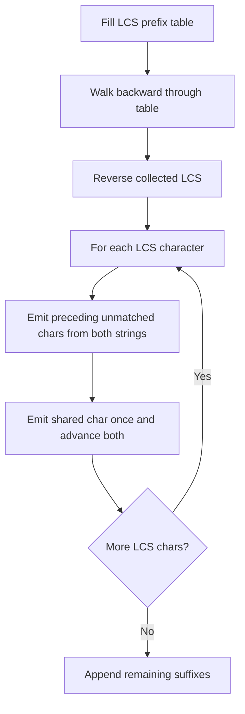

# Two-sequence DP: LCS reconstruction and SCS

[← Preparation roadmap](README.md)

## Recognize the pattern

Two strings can be aligned by matching characters or skipping characters, and subsequences need not be contiguous.

## Problems already in this project

- [dynamic-programming/03_LCS/scs_1.cpp](../dynamic-programming/03_LCS/scs_1.cpp)
- [dynamic-programming/03_LCS/scs_2.cpp](../dynamic-programming/03_LCS/scs_2.cpp)

## Core idea and invariant

dp[i][j] is the LCS length for prefixes a[0..i) and b[0..j). A match consumes both final characters; a mismatch drops one side. A shortest common supersequence shares each LCS character once.

## Example question

Given `a="abac"` and `b="cab"`, find an LCS and construct a shortest string containing both as subsequences.

**LCS:** `"ab"`, length 2.

**Shortest common supersequence:** `"cabac"`, length 5.

## Detailed explanation and diagram

The state refers to **prefix lengths**, so dp[i][j] is defined even when one prefix is empty. Matching final characters can be shared; otherwise an LCS must omit at least one of the two unequal final characters. This creates three local dependencies and an acyclic row/column evaluation order.

```text
                     b prefix:    empty  c  a  b
                         empty      0    0  0  0
                      a             0    0  1  1
                      ab            0    0  1  2
                      aba           0    0  1  2
                      abac          0    1  1  2

Match:    dp[i-1][j-1] + 1  (diagonal)
Mismatch: max(dp[i-1][j], dp[i][j-1]) (above or left)
```

Walking backward recovers actual shared characters rather than just a length. The SCS then merges unmatched characters around that shared backbone. Sharing L characters saves L copies from the naive total m+n, so the optimal length is m+n−L. An equal-length DP tie may select a different valid backbone and supersequence.

## Algorithm

1. Initialize the empty-prefix row and column to zero.
2. On a match use 1+dp[i−1][j−1]; otherwise use max(dp[i−1][j],dp[i][j−1]).
3. Reconstruct an LCS by walking backward: take matching characters; otherwise move to the better predecessor. Reverse the collected characters.
4. Build an SCS using three pointers: for each LCS character, emit unmatched characters from both strings, then emit the shared character once.
5. Append remaining suffixes. Both project files are versions of this same pipeline.

## Flowchart



## Pseudocode

The pseudocode uses the same state and update rules as the Java methods. Separate variants are named explicitly.

```text
LCS(a, b):
    dp = zero table with (m+1) rows and (n+1) columns
    for i from 1 through m:
        for j from 1 through n:
            if a[i-1] == b[j-1]: dp[i][j] = 1 + dp[i-1][j-1]
            else: dp[i][j] = max(dp[i-1][j], dp[i][j-1])
    walk from (m,n):
        on equal final characters: collect char; move diagonally
        otherwise move to the better predecessor
    reverse collected characters

SCS(a, b):
    shared = LCS(a,b); i = j = 0
    for c in shared:
        emit a[i] and advance until it equals c
        emit b[j] and advance until it equals c
        emit c once; advance both i and j
    append both remaining suffixes
```

## Java implementation

This is a corrected Java study implementation derived from the linked project problems, rather than a verbatim copy of their bugs. Save the entire block as the public class name plus `.java` and compile with Java 17 or later. Methods are called from a driver or test; these classes do not require a `main` method to compile.

```java
public class SequenceDP {
    public static String lcs(String a, String b) {
        int m = a.length(), n = b.length(); int[][] dp = new int[m+1][n+1];
        for (int i = 1; i <= m; i++) for (int j = 1; j <= n; j++)
            dp[i][j] = a.charAt(i-1) == b.charAt(j-1) ? 1 + dp[i-1][j-1] : Math.max(dp[i-1][j],dp[i][j-1]);
        StringBuilder reversed = new StringBuilder(); int i = m, j = n;
        while (i > 0 && j > 0) {
            if (a.charAt(i-1) == b.charAt(j-1)) { reversed.append(a.charAt(--i)); j--; }
            else if (dp[i-1][j] > dp[i][j-1]) i--; else j--;
        }
        return reversed.reverse().toString();
    }
    public static String shortestCommonSupersequence(String a, String b) {
        String shared = lcs(a,b); StringBuilder out = new StringBuilder(); int i = 0, j = 0;
        for (int k = 0; k < shared.length(); k++) {
            char c = shared.charAt(k);
            while (a.charAt(i) != c) out.append(a.charAt(i++));
            while (b.charAt(j) != c) out.append(b.charAt(j++));
            out.append(c); i++; j++;
        }
        return out.append(a.substring(i)).append(b.substring(j)).toString();
    }
}
```

## Step-by-step dry run

### Table filling

The diagram above gives every cell. Representative decisions:

| Cell | Compared characters | Transition | Value |
| --- | --- | --- | --- |
| dp[1][1] | a versus c | max(above=0,left=0) | 0 |
| dp[1][2] | a versus a | diagonal 0+1 | 1 |
| dp[2][3] | b versus b | diagonal dp[1][2]+1 | 2 |
| dp[4][1] | c versus c | diagonal dp[3][0]+1 | 1 |
| dp[4][3] | c versus b | max(above=2,left=1) | 2 |

### LCS reconstruction

| Position (i,j) | Decision | Collected backward |
| --- | --- | --- |
| (4,3) | c!=b; above is larger, move to (3,3) | `""` |
| (3,3) | a!=b; above is larger, move to (2,3) | `""` |
| (2,3) | b==b; collect b, move diagonally | `"b"` |
| (1,2) | a==a; collect a, move diagonally | `"ba"` |
| i=0 | Stop and reverse | `"ab"` |

### SCS reconstruction

| Shared character | i / j before | Unmatched characters emitted | Shared output | Result so far |
| --- | --- | --- | --- | --- |
| a | 0 / 0 | c from b | a once | `ca` |
| b | 1 / 2 | None | b once | `cab` |
| End | 2 / 3 | Remaining a suffix `ac` | — | `cabac` |

Both inputs occur in order in `cabac`, and its length is `4+3−2=5`.

## Complexity

O(mn + m+n) time, O(mn) table plus O(m+n) reconstruction/output storage. If only LCS length is required, rolling rows reduce table storage, but that alone does not preserve this reconstruction procedure.

## Common mistakes and source differences

Subsequence is not substring. Multiple valid LCS/SCS strings may exist; test length and subsequence properties instead of only one chosen string. Java omits the source’s debug LCS output. The implementation operates on UTF-16 code units.

## Related LeetCode practice

- [1143. Longest Common Subsequence](https://leetcode.com/problems/longest-common-subsequence/) — return the LCS length; the guide additionally reconstructs a string.
- [1092. Shortest Common Supersequence](https://leetcode.com/problems/shortest-common-supersequence/) — direct match to the complete pipeline.

The official problem links above were checked on 10 November 2026. Descriptions here are summaries; follow each link for the judge’s complete constraints and API.

## Practice and recall

Reconstruct an LCS from a small hand-filled table. Prove SCS length m+n−LCS. Test empty strings, identical strings, and disjoint alphabets.
