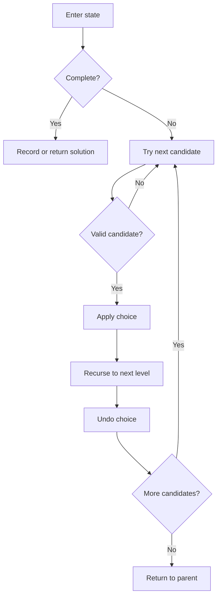

# Backtracking: subsets, N-Queens, and knight’s tour

[← Preparation roadmap](README.md)

## Recognize the pattern

Enumerate valid configurations, return one complete arrangement, or count solutions in a decision tree. Choices change a path or board and must be undone.

## Problems already in this project

- [recursion_backtracking/02_Backtracking/knights_tour.cpp](../recursion_backtracking/02_Backtracking/knights_tour.cpp)
- [recursion_backtracking/02_Backtracking/n_queens.cpp](../recursion_backtracking/02_Backtracking/n_queens.cpp)
- [recursion_backtracking/02_Backtracking/subset_sum_with_subsets.cpp](../recursion_backtracking/02_Backtracking/subset_sum_with_subsets.cpp)

## Core idea and invariant

Each recursive level fixes one decision. The current path/board describes exactly those choices. Choose → recurse → undo restores the parent state for the next branch.

## Example question

**Configuration question:** Place four queens on a 4×4 board so no two share a row, column, or diagonal. Return all valid boards. There are two solutions.

**Enumeration question:** Return index-distinct subsets of `[2,3,5]` with sum 5. The value lists are `[5]` and `[2,3]`.

## Detailed explanation and diagram

A recursive call fixes one level of decisions. For queens that level is a row, so row conflicts are impossible by construction. Columns and the two diagonal keys determine whether a new queen is valid. After recursion, unset exactly what was set; otherwise sibling branches inherit a queen they did not choose.

```text
First solution:             Column chosen at each row:
. Q . .                    row 0 -> 1
. . . Q                    row 1 -> 3
Q . . .                    row 2 -> 0
. . Q .                    row 3 -> 2

Diagonal keys:
  down = row - col + n
  up   = row + col
```

The queens search first tries column 0 at row 0, discovers that its branches cannot finish, and backs up before finding the displayed solution. Failed choices are useful evidence: they prune entire impossible suffixes.

Subset enumeration has two candidates at each index: skip and take. If values are non-negative, a negative remaining sum is impossible to repair. However, reaching sum zero before exhausting indices is not enough to stop when zeros remain; those zeros produce additional index-distinct answers. Memoizing only a count would be a DP variant, not a direct replacement for enumerating full paths.

## Algorithm

1. Subsets: at each index either skip or take the element. At index n, copy the path if remaining sum is zero. Non-negative values allow pruning negative remaining sums.
2. N-Queens: place one queen per row; track used columns and both diagonal identifiers for O(1) validity checks; copy a complete board.
3. Knight’s tour: mark the starting cell 0, try eight valid unvisited moves, recurse with the next step number, and undo on failure. Return immediately on the first complete tour.
4. The implementations deliberately distinguish all solutions (subsets/queens) from one solution (tour).

## Flowchart



## Pseudocode

The pseudocode uses the same state and update rules as the Java methods. Separate variants are named explicitly.

```text
QUEENS(row):
    if row == n: record a copy of board; return
    for col from 0 through n-1:
        if column or either diagonal is occupied: continue
        place queen and mark its column/diagonals
        QUEENS(row+1)
        remove queen and clear its marks

SUBSETS(i, remaining, path):
    if remaining < 0: return
    if i == n:
        if remaining == 0: record a copy of path
        return
    SUBSETS(i+1, remaining, path)
    append values[i]
    SUBSETS(i+1, remaining-values[i], path)
    remove last value

KNIGHT_TOUR(cell, step):
    if step == number of cells: return success
    try each valid unvisited knight destination:
        mark destination; recurse
        if successful: return success
        undo mark
    return failure
```

## Java implementation

This is a corrected Java study implementation derived from the linked project problems, rather than a verbatim copy of their bugs. Save the entire block as the public class name plus `.java` and compile with Java 17 or later. Methods are called from a driver or test; these classes do not require a `main` method to compile.

```java
import java.util.*;

public class Backtracking {
    public static List<List<Integer>> subsetsWithSum(int[] a, int target) {
        for (int x : a) if (x < 0) throw new IllegalArgumentException("Non-negative items required");
        List<List<Integer>> out = new ArrayList<>();
        subsets(a,0,target,new ArrayList<>(),out); return out;
    }
    private static void subsets(int[] a, int i, long remaining, List<Integer> path, List<List<Integer>> out) {
        if (remaining < 0) return;
        if (i == a.length) { if (remaining == 0) out.add(new ArrayList<>(path)); return; }
        subsets(a,i+1,remaining,path,out);
        path.add(a[i]); subsets(a,i+1,remaining-a[i],path,out); path.remove(path.size()-1);
    }
    public static List<List<String>> nQueens(int n) {
        if (n < 0) throw new IllegalArgumentException();
        char[][] board = new char[n][n]; for (char[] row : board) Arrays.fill(row,'.');
        List<List<String>> out = new ArrayList<>();
        queens(0,board,new boolean[n],new boolean[2*n],new boolean[2*n],out); return out;
    }
    private static void queens(int row, char[][] board, boolean[] column, boolean[] down, boolean[] up, List<List<String>> out) {
        int n = board.length;
        if (row == n) { List<String> answer = new ArrayList<>(); for (char[] r : board) answer.add(new String(r)); out.add(answer); return; }
        for (int col = 0; col < n; col++) {
            int d = row-col+n, u = row+col;
            if (column[col] || down[d] || up[u]) continue;
            board[row][col] = 'Q'; column[col] = down[d] = up[u] = true;
            queens(row+1,board,column,down,up,out);
            board[row][col] = '.'; column[col] = down[d] = up[u] = false;
        }
    }
    private static final int[][] MOVES = {{2,1},{2,-1},{1,2},{1,-2},{-2,1},{-2,-1},{-1,2},{-1,-2}};
    public static int[][] knightTour(int n) {
        if (n < 1) throw new IllegalArgumentException();
        int[][] board = new int[n][n]; for (int[] row : board) Arrays.fill(row,-1);
        board[0][0] = 0;
        return tour(board,0,0,1) ? board : new int[0][0];
    }
    private static boolean tour(int[][] board, int row, int col, int step) {
        int n = board.length; if (step == n*n) return true;
        for (int[] move : MOVES) {
            int r = row+move[0], c = col+move[1];
            if (r < 0 || r >= n || c < 0 || c >= n || board[r][c] != -1) continue;
            board[r][c] = step;
            if (tour(board,r,c,step+1)) return true;
            board[r][c] = -1;
        }
        return false;
    }
}
```

## Step-by-step dry run

### N-Queens branch trace

This table summarizes each placement decision and its failure/return; routine rejected-column checks are grouped.

| Step | Chosen columns by row so far | What happens next |
| --- | --- | --- |
| 1 | `[0]` | At row 1, columns 0 and 1 conflict; try 2 |
| 2 | `[0,2]` | Row 2 has no valid column; undo row 1 |
| 3 | `[0,3]` | Row 2 can use column 1 |
| 4 | `[0,3,1]` | Row 3 has no valid column; unwind to row 0 |
| 5 | `[1]` | Next first-row choice; row 1 can use column 3 |
| 6 | `[1,3]` | Row 2 can use column 0 |
| 7 | `[1,3,0]` | Row 3 can use column 2 |
| 8 | `[1,3,0,2]` | Four rows complete; copy the first board |
| 9 | Undo and continue searching | Eventually record `[2,0,3,1]`, the second board |

### Subset decision leaves

| Selected indices | Sum | Decision |
| --- | --- | --- |
| None | 0 | Reject |
| 2 only (value 5) | 5 | Record `[5]` |
| 1 only (value 3) | 3 | Reject |
| 1 and 2 | 8 | Prune when remaining becomes negative |
| 0 only (value 2) | 2 | Reject |
| 0 and 2 | 7 | Prune |
| 0 and 1 | 5 | Record `[2,3]` |
| 0,1,2 | 10 | Prune |

Because skip is explored before take, `[5]` is discovered before `[2,3]`. Output order is not essential to the question.

## Complexity

Subset enumeration O(n×2^n) including copying, O(n) recursion/path excluding results. N-Queens explores at most factorial-scale placements; this implementation also scans n columns at each partial state and copies O(n²) per solution, giving a safe O(n×n! + S×n²) upper bound and O(n²) board/state space excluding output. A crude knight-tour upper bound is O(8^(n²)) time, O(n²) board/stack.

## Common mistakes and source differences

Copy completed paths, not references to the live list. Equal-valued input elements remain distinct by index and may create identical value lists. Java checks subset completion only at exhaustion, so zeros are handled. N-Queens uses rows as levels rather than the source’s columns; both are equivalent. Exhaustive knight tours become expensive quickly.

## Related LeetCode practice

- [51. N-Queens](https://leetcode.com/problems/n-queens/) — direct match to the row-by-row all-solutions implementation.

The official problem links above were checked on 10 November 2026. Descriptions here are summaries; follow each link for the judge’s complete constraints and API.

## Practice and recall

Write down the level, candidates, validity condition, and undo operation before coding. Change all-solutions N-Queens to first-solution search and identify exactly where the early return belongs.
