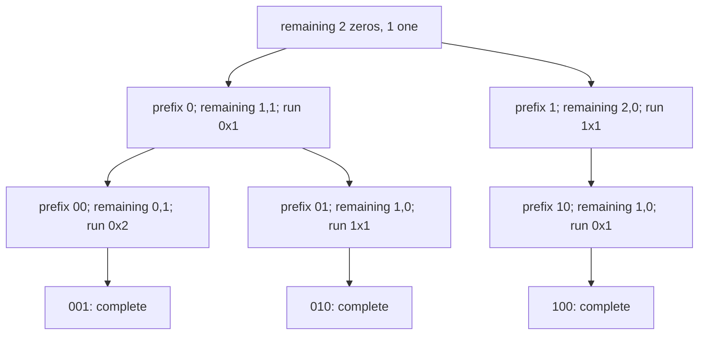
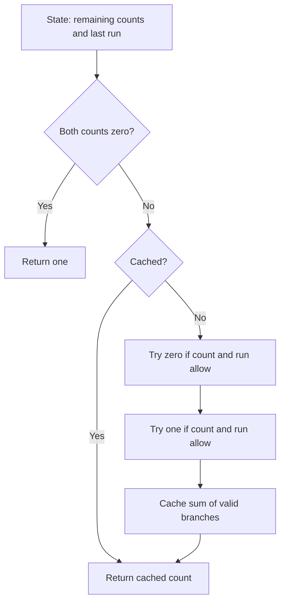

# Constrained counting DP: stable binary arrays

[← Preparation roadmap](README.md)

## Recognize the pattern

Count sequences with fixed symbol counts and a local constraint on consecutive symbols. Backtracking paths overlap once only remaining counts and recent history affect future choices.

## Problems already in this project

- [arrays/stable_binary_arr.cpp](../arrays/stable_binary_arr.cpp)

## Core idea and invariant

State = (zeros remaining, ones remaining, last bit, current run length). Different prefixes with the same state have exactly the same valid suffixes. The empty remaining suffix contributes one completed arrangement.

## Example question

Count binary arrays containing exactly two zeros and one one, with no run of equal bits longer than the limit.

**Input A:** zero=2, one=1, limit=2 → output `3`: `001,010,100`.

**Input B:** the same counts with limit=1 → output `1`: only `010`.

## Detailed explanation and diagram

The prefix itself does not need to be stored in the memo key. Future choices depend on remaining zeros/ones and the final run. But omitting the run is unsafe: with one zero and one one remaining and limit=2, state `(last=0,run=2)` permits only suffix `10`, while `(last=1,run=1)` permits `01` and `10`.



The diagram uses limit 2. The two first-bit branches are disjoint, so their counts add. Returning one at zero remaining counts means 'one completed suffix: the empty suffix.' Caching that suffix count lets different prefixes reuse work whenever all four state fields match. The limit is constant for the whole call and therefore need not be a key field in its per-call map.

## Algorithm

1. Start with the requested counts and no previous bit.
2. Try appending 0 only if zeros remain and either the last bit differs or the current run is shorter than limit.
3. Apply the symmetric rule for 1. Update the run length and remaining count.
4. Sum both valid branches and memoize by the full state.
5. Return one when both counts are zero. This guide counts exactly using BigInteger; it does not assume a problem-specific modulus.

## Flowchart



## Pseudocode

The pseudocode uses the same state and update rules as the Java methods. Separate variants are named explicitly.

```text
COUNT(zero, one, last, run):
    if zero == 0 and one == 0: return 1
    if full state is cached: return cached value
    total = 0
    if zero > 0 and (last != 0 or run < limit):
        nextRun = run+1 if last == 0, otherwise 1
        total += COUNT(zero-1, one, 0, nextRun)
    if one > 0 and (last != 1 or run < limit):
        nextRun = run+1 if last == 1, otherwise 1
        total += COUNT(zero, one-1, 1, nextRun)
    cache full state -> total
    return total

START:
    return COUNT(requestedZero, requestedOne, noPreviousBit, 0)
```

## Java implementation

This is a corrected Java study implementation derived from the linked project problems, rather than a verbatim copy of their bugs. Save the entire block as the public class name plus `.java` and compile with Java 17 or later. Methods are called from a driver or test; these classes do not require a `main` method to compile.

```java
import java.util.*;
import java.math.BigInteger;

public class StableArrays {
    private record State(int zero, int one, int last, int run) {}
    public static BigInteger count(int zero, int one, int limit) {
        if (zero < 0 || one < 0 || limit < 1) throw new IllegalArgumentException();
        return solve(zero,one,limit,-1,0,new HashMap<>());
    }
    private static BigInteger solve(int zero, int one, int limit, int last, int run, Map<State,BigInteger> memo) {
        if (zero == 0 && one == 0) return BigInteger.ONE;
        State state = new State(zero,one,last,run);
        if (memo.containsKey(state)) return memo.get(state);
        BigInteger answer = BigInteger.ZERO;
        if (zero > 0 && (last != 0 || run < limit))
            answer = answer.add(solve(zero-1,one,limit,0,last == 0 ? run+1 : 1,memo));
        if (one > 0 && (last != 1 || run < limit))
            answer = answer.add(solve(zero,one-1,limit,1,last == 1 ? run+1 : 1,memo));
        memo.put(state,answer); return answer;
    }
}
```

## Step-by-step dry run

State notation is `(zerosRemaining,onesRemaining,last,run)`; the initial last bit is “none”.

| Step | Prefix / state | limit=2 result | limit=1 difference |
| --- | --- | --- | --- |
| 1 | Empty / (2,1,none,0) | Try first 0 and first 1 | Same |
| 2 | 0 / (1,1,0,1) | Can append 0 or 1 | Cannot append another 0 |
| 3 | 00 / (0,1,0,2) | Only append 1 → complete 001 | Branch was disallowed |
| 4 | 01 / (1,0,1,1) | Append 0 → complete 010 | Same valid completion |
| 5 | 1 / (2,0,1,1) | Must append 0 | Same |
| 6 | 10 / (1,0,0,1) | Append 0 → complete 100 | Extra 0 disallowed; branch count 0 |
| 7 | Return from initial 0 branch | 1+1=2 | 1 |
| 8 | Return from initial 1 branch | 1 | 0 |
| 9 | Combine initial branches | 2+1=3 | 1+0=1 |

All completed arrays have the requested counts. No branch creates a run longer than the limit, so no final validation pass is needed. For larger inputs, memoization avoids re-expanding equal suffix states.

## Complexity

A safe bound is O((zero+1)(one+1)(min(limit,zero+one)+1)) states with constant branching, plus O(zero+one) stack depth. Space includes memoized BigInteger values; addition cost and stored bits grow with the exact count.

## Common mistakes and source differences

The original source ignores limit, does not enumerate both choices correctly, and has a non-progressing recursive branch. This is a replacement recurrence for its intended problem. Omitting last/run from the cache key merges inequivalent states. Large counts/depth need a more optimized tabulation or modulus-specific solution.

## Related LeetCode practice

- [3129. Find All Possible Stable Binary Arrays I](https://leetcode.com/problems/find-all-possible-stable-binary-arrays-i/) — same run constraint, but the judge requires the count modulo 1,000,000,007. The study implementation returns an exact BigInteger; adapt numeric representation and performance to the judge limits.

The official problem links above were checked on 10 November 2026. Descriptions here are summaries; follow each link for the judge’s complete constraints and API.

## Practice and recall

Draw the decision tree for (2,2,1). Explain why two equal remaining-count states can have different answers if their last runs differ. Cross-check tiny states by enumerating bit strings.
