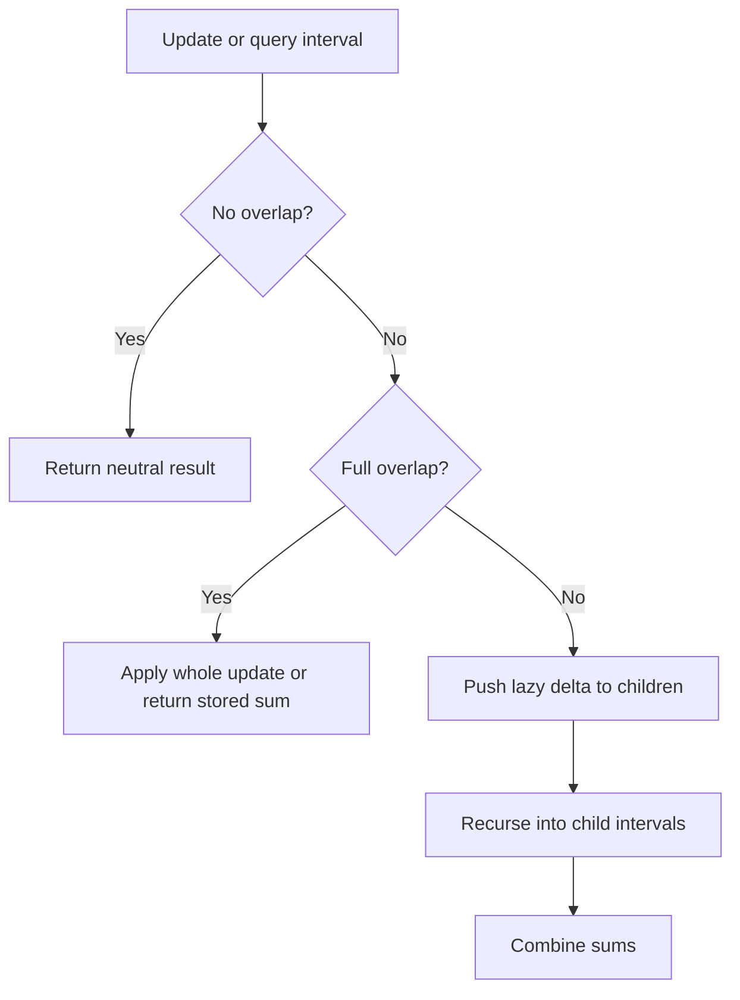

# Range patterns: difference array and lazy segment tree

[← Preparation roadmap](README.md)

## Recognize the pattern

Many interval updates followed by one final result suggest a difference array. Interleaved updates and sum queries suggest a segment tree with lazy propagation.

## Problems already in this project

- [arrays/toggle.py](../arrays/toggle.py)
- [range queries/segment_tree.cpp](../range%20queries/segment_tree.cpp)

## Core idea and invariant

Difference array: a range addition changes only its entry and exit boundaries. Lazy tree: tree[node] already contains all updates for its interval; lazy[node] records what its children have not yet received.

## Example question

**Offline question:** Bulbs `[0,1,0,1]` are toggled over inclusive ranges `[0,2]` and `[1,3]`. Find their final states. Expected result: `[1,1,0,0]`.

**Online question:** For `[1,3,5,7,9,11]`, query sum(1,3), add 10 to indices 1..3, then query sum(1,3) again. Expected results: 15 and 45.

## Detailed explanation and diagram

A difference marker describes a change in coverage, not the final value. Entering an update interval adds one active toggle; leaving it cancels that toggle. Prefix accumulation reconstructs how many updates cover each position. An even number cancels and an odd number flips.

```text
Index:               0  1  2  3  4 (exit slot)
Update [0,2]:       +1        -1
Update [1,3]:          +1        -1
Combined diff:       1  1  0 -1 -1
Prefix coverage:     1  2  2  1
Toggle parity:       1  0  0  1
Original bulbs:      0  1  0  1
Final bulbs:         1  1  0  0
```

An online tree is needed when a range sum must be available between updates. Each tree node represents a whole interval. A full-cover addition changes its sum by length×delta. Lazy information says that the parent sum is already current, but descendants still need the delta before a partial visit. This distinction avoids touching every leaf on every update.

```text
                     [0..5] sum=36
                    /             \
           [0..2] sum=9         [3..5] sum=27
           /         \          /          \
    [0..1] sum=4   [2]=5  [3..4] sum=16   [5]=11
```

## Algorithm

1. Offline toggles: add 1 at l and subtract 1 at r+1 in an n+1 difference array. Prefix-accumulate; toggle when coverage count is odd.
2. Segment tree: recursively build sums over inclusive intervals.
3. Full-overlap update: add intervalLength×delta to the stored sum and delta to its lazy value.
4. Partial update/query: push lazy values to children before recursing. Recombine child sums after updates.
5. No-overlap queries contribute zero. The API validates bounds and requires a nonempty segment-tree input.

## Flowchart



## Pseudocode

The pseudocode uses the same state and update rules as the Java methods. Separate variants are named explicitly.

```text
TOGGLE_ALL(bulbs, ranges):
    result = copy of bulbs
    diff[0..n] = 0
    for each inclusive [l,r]: diff[l]++; diff[r+1]--
    coverage = 0
    for i from 0 through n-1:
        coverage += diff[i]
        if coverage is odd: flip result[i]

RANGE_ADD(node, interval, query, delta):
    if disjoint: return
    if fully covered:
        sum[node] += intervalLength * delta
        lazy[node] += delta
        return
    push pending delta to both children
    update both child intervals
    sum[node] = sum[leftChild] + sum[rightChild]

RANGE_SUM(node, interval, query):
    if disjoint: return 0
    if fully covered: return sum[node]
    push pending delta to both children
    return left query + right query
```

## Java implementation

This is a corrected Java study implementation derived from the linked project problems, rather than a verbatim copy of their bugs. Save the entire block as the public class name plus `.java` and compile with Java 17 or later. Methods are called from a driver or test; these classes do not require a `main` method to compile.

```java
public class RangeQueries {
    public static int[] toggle(int[] bulbs, int[][] ranges) {
        int n = bulbs.length; long[] difference = new long[n+1];
        for (int[] range : ranges) {
            int l = range[0], r = range[1];
            if (l < 0 || l > r || r >= n) throw new IllegalArgumentException();
            difference[l]++; difference[r+1]--;
        }
        int[] result = bulbs.clone(); long covering = 0;
        for (int i = 0; i < n; i++) {
            if (result[i] != 0 && result[i] != 1) throw new IllegalArgumentException("Binary bulbs required");
            covering += difference[i]; if ((covering & 1) != 0) result[i] ^= 1;
        }
        return result;
    }
    public static class SegmentTree {
        private final int n; private final long[] sum, lazy;
        public SegmentTree(int[] values) {
            if (values.length == 0) throw new IllegalArgumentException("Empty tree");
            n = values.length; sum = new long[4*n]; lazy = new long[4*n]; build(1,0,n-1,values);
        }
        private void build(int node, int left, int right, int[] values) {
            if (left == right) { sum[node] = values[left]; return; }
            int mid = left+(right-left)/2;
            build(node*2,left,mid,values); build(node*2+1,mid+1,right,values);
            sum[node] = sum[node*2]+sum[node*2+1];
        }
        private void apply(int node, int left, int right, long delta) {
            sum[node] += (right-left+1L)*delta; lazy[node] += delta;
        }
        private void push(int node, int left, int right) {
            if (lazy[node] == 0 || left == right) return;
            int mid = left+(right-left)/2;
            apply(node*2,left,mid,lazy[node]); apply(node*2+1,mid+1,right,lazy[node]); lazy[node] = 0;
        }
        private void bounds(int left, int right) {
            if (left < 0 || left > right || right >= n) throw new IllegalArgumentException();
        }
        public void add(int left, int right, long delta) { bounds(left,right); add(1,0,n-1,left,right,delta); }
        private void add(int node, int left, int right, int ql, int qr, long delta) {
            if (qr < left || right < ql) return;
            if (ql <= left && right <= qr) { apply(node,left,right,delta); return; }
            push(node,left,right); int mid = left+(right-left)/2;
            add(node*2,left,mid,ql,qr,delta); add(node*2+1,mid+1,right,ql,qr,delta);
            sum[node] = sum[node*2]+sum[node*2+1];
        }
        public long sum(int left, int right) { bounds(left,right); return query(1,0,n-1,left,right); }
        private long query(int node, int left, int right, int ql, int qr) {
            if (qr < left || right < ql) return 0;
            if (ql <= left && right <= qr) return sum[node];
            push(node,left,right); int mid = left+(right-left)/2;
            return query(node*2,left,mid,ql,qr)+query(node*2+1,mid+1,right,ql,qr);
        }
    }
}
```

## Step-by-step dry run

### Offline difference reconstruction

After both updates, diff is `[1,1,0,-1,-1]`.

| i | diff[i] | Running coverage | Original bulb | Operation | Final bulb |
| --- | --- | --- | --- | --- | --- |
| 0 | 1 | 1 | 0 | Odd → flip | 1 |
| 1 | 1 | 2 | 1 | Even → unchanged | 1 |
| 2 | 0 | 2 | 0 | Even → unchanged | 0 |
| 3 | −1 | 1 | 1 | Odd → flip | 0 |

The exit slot 4 is not a bulb and need not be output.

### Online sum and update

| Step | Tree action | Result |
| --- | --- | --- |
| 1 | Query [1,3] intersects both root children | Combine values 3+5+7=15 |
| 2 | Add 10 over [1,3]; [0,2] partially overlaps | Descend and update leaves 1 and 2 |
| 3 | [3,5] also partially overlaps | Descend and update leaf 3 |
| 4 | Recombine changed ancestors | Root sum becomes 36+3×10=66 |
| 5 | Query [1,3] again | 13+15+17=45 |

That particular update reaches leaves because its boundaries cut across this tree. To see laziness directly, next add 2 over the full interval [0,5]: only root sum changes from 66 to 78 and root.lazy becomes 2. A full sum query returns 78 immediately. A later point query at index 0 pushes this delta along its path, then returns 3 instead of the original 1.

## Complexity

Difference array: O(n+q) time, O(n) space including returned array. Segment tree: O(n) build, O(log n) per interval add/query, O(n) storage. Sums/deltas use long; inputs must still fit long arithmetic.

## Common mistakes and source differences

Inclusive r needs an r+1 marker. Toggle parity is not the same as assigning the coverage count. This tree supports range addition, not range assignment. Lazy semantics differ from the source’s deferred-sum convention; keep the invariant internally consistent. Java removes the source’s stray unused expression and handles empty construction explicitly.

## Related LeetCode practice

- [1109. Corporate Flight Bookings](https://leetcode.com/problems/corporate-flight-bookings/) — difference-array application: use seat counts instead of toggle increments and convert one-based flight labels to zero-based indices.
- [307. Range Sum Query - Mutable](https://leetcode.com/problems/range-sum-query-mutable/) — related tree problem with point assignment, not range addition. To reuse this API, convert setting index i to value v into add(i,i,v−currentValue), and adapt the class signature.

The official problem links above were checked on 10 November 2026. Descriptions here are summaries; follow each link for the judge’s complete constraints and API.

## Practice and recall

Compare 100 random interval operations with a plain array. Explain when a difference array cannot answer a query online without rebuilding the prefix values.
