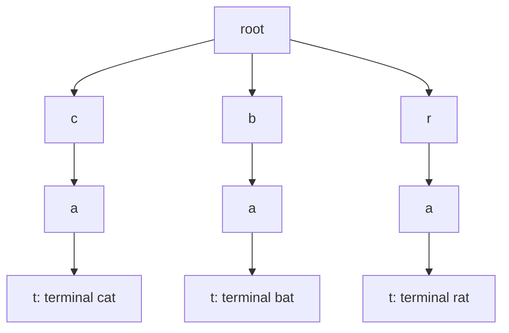
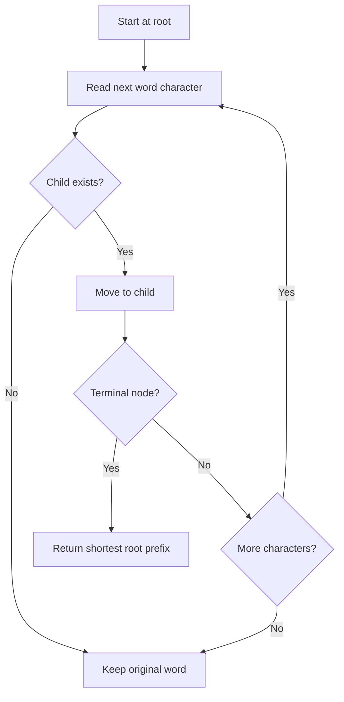

# Trie: dictionary search and shortest root replacement

[← Preparation roadmap](README.md)

## Recognize the pattern

Many words share prefixes, or each sentence word must be replaced by the shortest dictionary root that prefixes it.

## Problems already in this project

- [strings/replace_words.py](../strings/replace_words.py)
- [strings/trie.py](../strings/trie.py)

## Core idea and invariant

Each edge represents the next character. A terminal marker means a complete dictionary word ends here; a prefix path alone does not imply a complete word.

## Example question

Given dictionary roots `["cat","bat","rat"]`, replace each sentence word with its shortest matching root, leaving unmatched words unchanged.

**Input sentence:** `"the cattle was rattled by the battery"`

**Output:** `"the cat was rat by the bat"`.

## Detailed explanation and diagram

A trie stores common prefixes once. Walking a word follows successive characters, and a terminal flag tells whether the prefix so far is a complete dictionary entry. For ordinary search you must consume the full word and end at a terminal; for root replacement, the first terminal wins because every later terminal would be a longer root.



Dictionary roots `cat` and `cattle` could coexist: when processing `cattle`, reaching the terminal after `cat` is enough, so the longer path must not override it. Failure before any terminal means no root can match, because all longer roots would need the missing edge too. A new trie per replacement call prevents a previous dictionary from leaking into a later question.

## Algorithm

1. Insert each character, creating missing child nodes, then mark the final node terminal.
2. Search follows the entire word and checks terminal; startsWith checks only that the path exists.
3. For root replacement, stop on the first terminal node while scanning a word. That is necessarily its shortest dictionary root.
4. Build a fresh trie for each replacement call, split sentence whitespace, and join replaced words with single spaces. Empty dictionary roots are rejected to keep replacement meaningful.

## Flowchart



## Pseudocode

The pseudocode uses the same state and update rules as the Java methods. Separate variants are named explicitly.

```text
INSERT(word):
    node = root
    for c in word: create child c if absent; move to child c
    mark node terminal

SHORTEST_ROOT(word):
    node = root
    for each character at index i:
        if child is absent: return original word
        move to child
        if terminal: return word prefix through i
    return original word

REPLACE_WORDS(dictionary, sentence):
    build a fresh trie from nonempty roots
    split sentence into words
    replace each using SHORTEST_ROOT
    join using single spaces
```

## Java implementation

This is a corrected Java study implementation derived from the linked project problems, rather than a verbatim copy of their bugs. Save the entire block as the public class name plus `.java` and compile with Java 17 or later. Methods are called from a driver or test; these classes do not require a `main` method to compile.

```java
import java.util.*;

public class TriePattern {
    private static class Node { Map<Character,Node> children = new HashMap<>(); boolean terminal; }
    private final Node root = new Node();
    public void insert(String word) {
        Node node = root;
        for (char c : word.toCharArray()) node = node.children.computeIfAbsent(c, ignored -> new Node());
        node.terminal = true;
    }
    private Node walk(String text) {
        Node node = root;
        for (char c : text.toCharArray()) { node = node.children.get(c); if (node == null) return null; }
        return node;
    }
    public boolean search(String word) { Node node = walk(word); return node != null && node.terminal; }
    public boolean startsWith(String prefix) { return walk(prefix) != null; }
    private String shortestRoot(String word) {
        Node node = root;
        for (int i = 0; i < word.length(); i++) {
            node = node.children.get(word.charAt(i)); if (node == null) return word;
            if (node.terminal) return word.substring(0,i+1);
        }
        return word;
    }
    public static String replaceWords(List<String> dictionary, String sentence) {
        TriePattern trie = new TriePattern();
        for (String root : dictionary) {
            if (root.isEmpty()) throw new IllegalArgumentException("Empty root");
            trie.insert(root);
        }
        String trimmed = sentence.strip(); if (trimmed.isEmpty()) return "";
        String[] words = trimmed.split("\\s+");
        for (int i = 0; i < words.length; i++) words[i] = trie.shortestRoot(words[i]);
        return String.join(" ",words);
    }
}
```

## Step-by-step dry run

### Build the dictionary

Insert c→a→t and mark t terminal; insert b→a→t; insert r→a→t. Even though labels such as a repeat, each belongs to its own parent path.

### Trace “cattle”

| Character index | Character | Prefix reached | Terminal? | Action |
| --- | --- | --- | --- | --- |
| 0 | c | c | No | Continue |
| 1 | a | ca | No | Continue |
| 2 | t | cat | Yes | Return cat immediately |
| 3–5 | t,l,e | Not visited | — | Longer suffix is irrelevant |

### Process the complete sentence

| Word | Trie result | Why |
| --- | --- | --- |
| the | the | No root edge t |
| cattle | cat | First terminal at c→a→t |
| was | was | No root edge w |
| rattled | rat | First terminal at r→a→t |
| by | by | Root b exists but child y does not |
| the | the | No root edge t |
| battery | bat | First terminal at b→a→t |

Joining the seven results gives `the cat was rat by the bat`.

**Search distinction:** after inserting only `apple`, search("app") is false but startsWith("app") is true. Marking the p node terminal by inserting `app` changes only the full-word answer.

## Complexity

Expected O(L) insert/search per L-character word with hash-map children. Building/replacing costs expected O(total dictionary characters + sentence characters); storage is O(dictionary prefix nodes + output).

## Common mistakes and source differences

The original replacement Solution accumulates dictionary entries across calls; Java rebuilds per request. Matching is case-sensitive and uses UTF-16 code units. Replacement normalizes whitespace rather than preserving original spacing.

## Related LeetCode practice

- [208. Implement Trie (Prefix Tree)](https://leetcode.com/problems/implement-trie-prefix-tree/) — direct insert/search/startsWith operations; adapt constructor and class names.
- [648. Replace Words](https://leetcode.com/problems/replace-words/) — direct shortest-root replacement problem.

The official problem links above were checked on 10 November 2026. Descriptions here are summaries; follow each link for the judge’s complete constraints and API.

## Practice and recall

Test a dictionary containing both a short root and a longer root. Explain why terminal differs from having children and why the first terminal wins.
