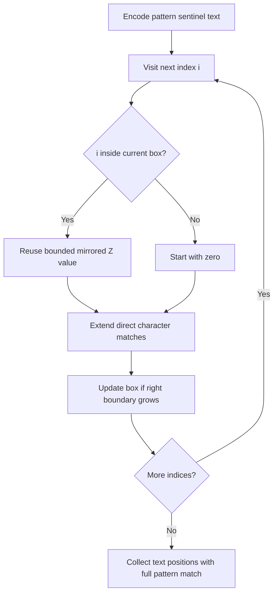

# Z algorithm: linear prefix matching

[← Preparation roadmap](README.md)

## Recognize the pattern

Find all exact occurrences of a pattern, including overlaps, by reusing longest-prefix matches inside a known matching interval.

## Problems already in this project

- [strings/z.py](../strings/z.py)

## Core idea and invariant

Maintain a half-open Z-box [left,right) matching a prefix. Inside it, initialize z[i] from the mirrored prefix result, bounded by right−i, then extend only beyond the known match.

## Example question

Find **all** starting indices of pattern `"aa"` in text `"aaaa"`, including overlaps.

**Output:** `[0,1,2]`. The related first-occurrence question would return only 0.

## Detailed explanation and diagram

Z[i] measures a match between the whole sequence's prefix and the suffix beginning at i. Inside a previously matched box `[left,right)`, a mirrored Z value already describes some of that work. Reuse at most `right−i` characters because anything beyond right has not yet been established for this box; then extend directly.

```text
Encoded sequence:  a  a  #  a  a  a  a
Index:             0  1  2  3  4  5  6
Meaning:          pattern #    text
Z value:           0  1  0  2  2  2  1
Text start:                 0  1  2  3

# represents integer -1, not an input character.
After i=3: box [3,5) matches prefix [0,2).
At i=4: reuse one character, then extend one more.
```

The sentinel prevents a pattern-prefix match from silently passing through its boundary. Encoding characters as non-negative UTF-16 values and the separator as −1 guarantees that collision is impossible, unlike choosing a character such as `$`. Only text positions can be returned as answers. The right boundary never retreats, bounding all successful direct extensions together by the sequence length.

## Algorithm

1. Encode pattern characters, a sentinel −1, then text characters as integers; −1 cannot collide with a UTF-16 character.
2. For each i>0, reuse a prior Z value if i is inside the Z-box.
3. Extend while the prefix and suffix characters match, then update the box if the right edge grows.
4. Inspect only positions corresponding to text, and report matches with z[i]>=pattern length.
5. This API defines the empty pattern as matching at every boundary, 0 through text.length().

## Flowchart



## Pseudocode

The pseudocode uses the same state and update rules as the Java methods. Separate variants are named explicitly.

```text
Z(sequence):
    left = right = 0; z = all zeros
    for i from 1 through length-1:
        if i < right: z[i] = min(right-i, z[i-left])
        while next prefix and suffix elements match: z[i]++
        if i+z[i] > right: left = i; right = i+z[i]
    return z

SEARCH(text, pattern):
    if pattern empty: return every boundary 0..length(text)
    sequence = integer pattern + [-1] + integer text
    z = Z(sequence)
    for i in text portion only:
        if z[i] >= pattern length: record i-patternLength-1
```

## Java implementation

This is a corrected Java study implementation derived from the linked project problems, rather than a verbatim copy of their bugs. Save the entire block as the public class name plus `.java` and compile with Java 17 or later. Methods are called from a driver or test; these classes do not require a `main` method to compile.

```java
import java.util.*;

public class ZAlgorithm {
    public static int[] z(int[] sequence) {
        int n = sequence.length; int[] z = new int[n]; int left = 0, right = 0;
        for (int i = 1; i < n; i++) {
            if (i < right) z[i] = Math.min(right-i,z[i-left]);
            while (i+z[i] < n && sequence[z[i]] == sequence[i+z[i]]) z[i]++;
            if (i+z[i] > right) { left = i; right = i+z[i]; }
        }
        return z;
    }
    public static List<Integer> search(String text, String pattern) {
        int m = pattern.length(), n = text.length(); List<Integer> matches = new ArrayList<>();
        if (m == 0) { for (int i = 0; i <= n; i++) matches.add(i); return matches; }
        int[] sequence = new int[m+1+n];
        for (int i = 0; i < m; i++) sequence[i] = pattern.charAt(i);
        sequence[m] = -1;
        for (int i = 0; i < n; i++) sequence[m+1+i] = text.charAt(i);
        int[] z = z(sequence);
        for (int i = m+1; i < sequence.length; i++) if (z[i] >= m) matches.add(i-m-1);
        return matches;
    }
}
```

## Step-by-step dry run

For the encoded `aa#aaaa`, initial Z is all zero and the box is [0,0).

| i | Inside box before? | Reused length | Direct extension | z[i] | Box after |
| --- | --- | --- | --- | --- | --- |
| 1 | No | 0 | a matches a; next comparison hits sentinel | 1 | [1,2) |
| 2 | No | 0 | a!=sentinel | 0 | [1,2) |
| 3 | No | 0 | Two a values match; sentinel!=a | 2 | [3,5) |
| 4 | Yes | min(1,z[1])=1 | One additional a matches | 2 | [4,6) |
| 5 | Yes | min(1,z[1])=1 | One additional a matches | 2 | [5,7) |
| 6 | Yes | min(1,z[1])=1 | Sequence ends; no further comparison | 1 | [5,7) |

Inspect encoded indices 3..6 only. At 3,4,5 the matched length is at least 2; subtract the pattern-plus-sentinel length 3 to obtain text positions 0,1,2. Encoded index 6 has only one matching character, so it cannot hold the full pattern.

**Collision check:** text `a$a`, pattern `a` still returns `[0,2]` because −1 is distinct from the character `$`.

## Complexity

O(n+m) time and O(n+m) space, plus returned indices. Every extension beyond the box advances a right boundary that never retreats.

## Common mistakes and source differences

The project hardcodes $ as separator and scans pattern positions as well; that can miss matches or report invalid indices. Java uses a collision-free integer sentinel and scans only text positions. Returned indices count UTF-16 units.

## Related LeetCode practice

- [28. Find the Index of the First Occurrence in a String](https://leetcode.com/problems/find-the-index-of-the-first-occurrence-in-a-string/) — apply the Z search, return the first match or −1 instead of the full list. Z is one valid method, not a requirement of the problem.

The official problem links above were checked on 10 November 2026. Descriptions here are summaries; follow each link for the judge’s complete constraints and API.

## Practice and recall

Derive the Z-box invariant and trace `aaaaa`. Compare results with a simple substring search on randomly generated small strings including $.
