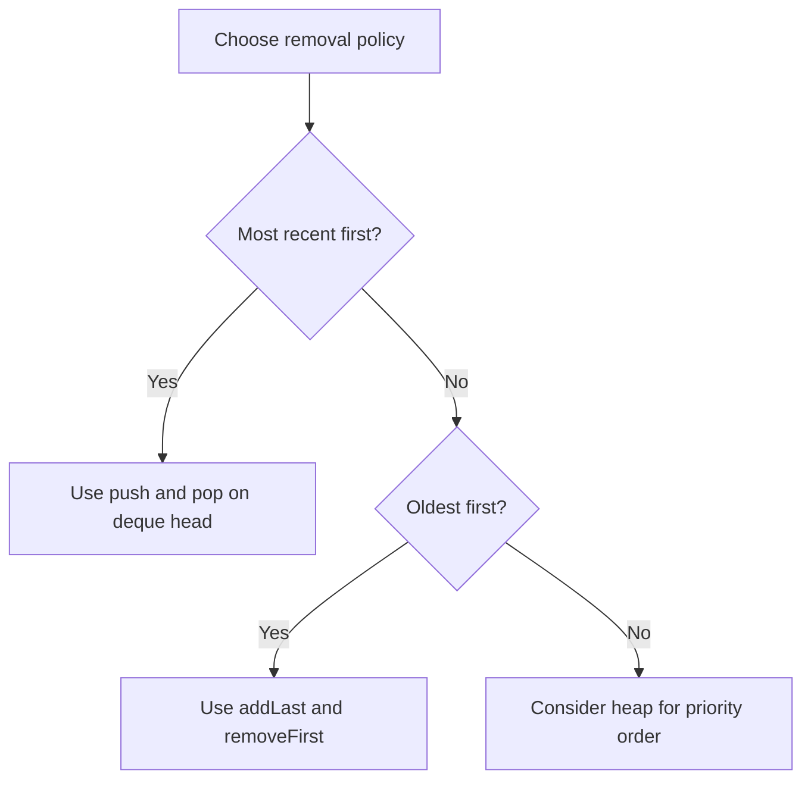

# Java foundations: stacks and queues

[← Preparation roadmap](README.md)

## Recognize the pattern

Use LIFO for pending branch work, undo history, and monotonic stacks; FIFO for BFS and arrival order. These are supporting structures, not complete algorithms.

## Problems already in this project

- [stacks_queues/queues.cpp](../stacks_queues/queues.cpp)
- [stacks_queues/queues.java](../stacks_queues/queues.java)
- [stacks_queues/queues.py](../stacks_queues/queues.py)
- [stacks_queues/stacks.cpp](../stacks_queues/stacks.cpp)
- [stacks_queues/stacks.java](../stacks_queues/stacks.java)
- [stacks_queues/stacks.py](../stacks_queues/stacks.py)

## Core idea and invariant

Use ArrayDeque through the Deque interface. Keep one convention: push/pop/peek at the head for a stack; addLast/removeFirst for a queue.

## Example question

Insert values 1,2,3 into a stack and into a queue. Remove every value from each structure.

**Expected stack order:** `[3,2,1]`.

**Expected queue order:** `[1,2,3]`.

**Application question:** Why is a stack the natural structure for matching nested brackets such as `([])`?

## Detailed explanation and diagram

A deque exposes both ends, so the removal discipline comes from the method choices. `push` and `pop` both operate at the head: the newest value is removed first. A queue appends with `addLast` and removes with `removeFirst`: the oldest value exits first. Mixing the conventions accidentally changes the algorithm using the structure.

```text
Stack after push 1,2,3:
  head / top -> [3] [2] [1]
  pop reads       3, then 2, then 1

Queue after addLast 1,2,3:
  head / front -> [1] [2] [3] <- tail
  removeFirst      1, then 2, then 3
```

For nested brackets, the most recent unmatched opener must be closed first. That is exactly LIFO. For BFS, earlier discovered vertices must be processed first to preserve distance layers, which is FIFO. The container choice is therefore justified by an invariant in the surrounding algorithm, not by habit. Priority order is a third policy and belongs to a heap.

## Algorithm

1. Stack: push each input, then pop to observe reverse order.
2. Queue: addLast each input, then removeFirst to preserve arrival order.
3. Check isEmpty before removal. ArrayDeque does not accept null.
4. Choose PriorityQueue only when removal should follow priority rather than insertion order.

## Flowchart



## Pseudocode

The pseudocode uses the same state and update rules as the Java methods. Separate variants are named explicitly.

```text
STACK_ORDER(values):
    deque = empty
    for value in values: push value at head
    result = empty list
    while deque not empty: append pop-from-head to result
    return result

QUEUE_ORDER(values):
    deque = empty
    for value in values: append value at tail
    while deque not empty: append remove-from-head to result
    return result

BRACKET_EXTENSION(s):
    for each character:
        if opener: push it
        otherwise require and pop its matching most recent opener
    accept only if no mismatch occurred and stack is empty
```

## Java implementation

This is a corrected Java study implementation derived from the linked project problems, rather than a verbatim copy of their bugs. Save the entire block as the public class name plus `.java` and compile with Java 17 or later. Methods are called from a driver or test; these classes do not require a `main` method to compile.

```java
import java.util.*;

public class StackQueueBasics {
    public static List<Integer> stackOrder(int[] values) {
        Deque<Integer> stack = new ArrayDeque<>();
        for (int value : values) stack.push(value);
        List<Integer> result = new ArrayList<>();
        while (!stack.isEmpty()) result.add(stack.pop()); return result;
    }
    public static List<Integer> queueOrder(int[] values) {
        Deque<Integer> queue = new ArrayDeque<>();
        for (int value : values) queue.addLast(value);
        List<Integer> result = new ArrayList<>();
        while (!queue.isEmpty()) result.add(queue.removeFirst()); return result;
    }
}
```

## Step-by-step dry run

Deque state is listed head → tail.

| Operation | Stack state | Queue operation | Queue state |
| --- | --- | --- | --- |
| push 1 | `[1]` | addLast 1 | `[1]` |
| push 2 | `[2,1]` | addLast 2 | `[1,2]` |
| push 3 | `[3,2,1]` | addLast 3 | `[1,2,3]` |
| pop → 3 | `[2,1]` | removeFirst → 1 | `[2,3]` |
| pop → 2 | `[1]` | removeFirst → 2 | `[3]` |
| pop → 1 | `[]` | removeFirst → 3 | `[]` |

### Nested-bracket extension

This traces the extension pseudocode, not a method already provided by StackQueueBasics.

| Character | Action | Unmatched openers, bottom → top |
| --- | --- | --- |
| ( | Push | `(` |
| [ | Push | `( [` |
| ] | Pop matching [ | `(` |
| ) | Pop matching ( | Empty |

No mismatch occurred and the stack is empty, so `([])` is valid. Input `([)]` fails at `)` because the latest unmatched opener is `[`, not `(`.

## Complexity

O(n) total time and space; ArrayDeque end operations are amortized O(1). A PriorityQueue insertion/removal is O(log n), not O(1).

## Common mistakes and source differences

Legacy java.util.Stack works but ArrayDeque is a simpler modern stack choice. Iterating a PriorityQueue does not return a sorted sequence. Avoid removing index 0 from an ArrayList to simulate a queue.

## Related LeetCode practice

- [20. Valid Parentheses](https://leetcode.com/problems/valid-parentheses/) — a follow-up applying stack discipline. The existing stack-order demonstration is a foundation, not a complete bracket validator.

The official problem links above were checked on 10 November 2026. Descriptions here are summaries; follow each link for the judge’s complete constraints and API.

## Practice and recall

Implement BFS with the queue convention, then a nearest-smaller solution with the stack convention. Explain which end each method uses.
