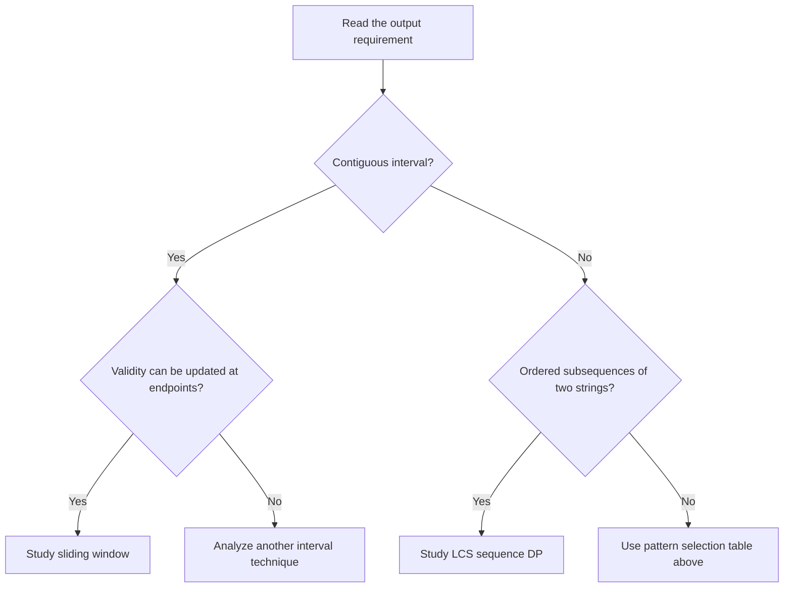

# DSA preparation by pattern — Java

Track your learning, LeetCode acceptances, and spaced reviews in the [progress tracker](TRACKER.md). Keep the [Java basics and data-structures cheatsheet](JAVA_CHEATSHEET.md) open while practicing.

These guides are based on the DSA problems in this project. Each contains recognition signals, an invariant/state, an algorithm, a Mermaid flowchart, corrected Java code, a question, detailed diagrams, pseudocode, a step-by-step dry run, complexity, related LeetCode practice, and recall exercises. Original source files remain in place.

## Study order

| Order | Pattern | What to learn |
| --- | --- | --- |
| 1 | [Two pointers: partition and alternating placement](01_two_pointers.md) | Two moving indices; partitioning and alternating placement |
| 2 | [Sliding window: minimum window substring](02_sliding_window.md) | Expand/shrink contiguous windows with counts |
| 3 | [Hashing and ordered maps: membership and frequencies](03_hashing.md) | Membership, ordered sets, and frequency maps |
| 4 | [Sorting and divide and conquer](04_sorting.md) | Merge sort, quick sort, and custom comparison |
| 5 | [Monotonic stacks: nearest neighbors and histogram](05_monotonic_stack.md) | Nearest greater/smaller and histogram widths |
| 6 | [Heap and greedy: merge cost, Kruskal, fair allocation](06_heap_greedy.md) | Rod merge cost, DSU/Kruskal, batch fairness |
| 7 | [Linked lists: CRUD, fast/slow pointers, reversal, merge sort](07_linked_lists.md) | Rewiring, cycle entry, intersection, merge sort |
| 8 | [Graph representation, BFS, DFS, and paths](08_graph_traversal.md) | BFS/DFS, adjacency representations, paths |
| 9 | [Cycle detection and topological ordering](09_cycles_topological.md) | Gray-stack cycle tests and dependency order |
| 10 | [Grid traversal: flood fill and shortest knight moves](10_grid_traversal.md) | Flood fill versus shortest-move BFS |
| 11 | [Tree recursion: aggregates, structure, paths, LCA, diameter](11_tree_recursion.md) | Subtree return contracts, paths, LCA, diameter |
| 12 | [DP foundations: linear states and memoization](12_dp_foundations.md) | State, base cases, memoization, tabulation |
| 13 | [Knapsack family: 0/1, subsets, coin change, target sum](13_knapsack.md) | 0/1 versus unbounded; feasibility/minimum/count |
| 14 | [Two-sequence DP: LCS reconstruction and SCS](14_lcs_scs.md) | Two-prefix states, LCS reconstruction, SCS |
| 15 | [Backtracking: subsets, N-Queens, and knight’s tour](15_backtracking.md) | Choose/recurse/undo and configuration enumeration |
| 16 | [Constrained counting DP: stable binary arrays](16_constrained_counting_dp.md) | Memoizing constrained sequence counts |
| 17 | [Range patterns: difference array and lazy segment tree](17_range_queries.md) | Offline differences versus online lazy trees |
| 18 | [Trie: dictionary search and shortest root replacement](18_trie.md) | Shared prefixes and shortest dictionary roots |
| 19 | [Z algorithm: linear prefix matching](19_z_algorithm.md) | Reusing prefix matches in linear time |
| 20 | [Java foundations: stacks and queues](20_stack_queue_basics.md) | Deque semantics supporting the other patterns |

Start with [stack/queue basics](20_stack_queue_basics.md) if Java collections are unfamiliar. Then follow 1–5, 7–11, 15, 12–14, 16, 6, and 17–19. This sequence introduces recursion/backtracking before DP optimization.

## Pattern selection

| Problem signal | First candidate |
| --- | --- |
| Contiguous substring with mutable validity | Sliding window |
| Segregation, monotone scans, linked-list speeds | Two pointers |
| Nearest greater/smaller or maximal bounded span | Monotonic stack |
| Connectivity / equal-cost shortest path | DFS / BFS |
| Dependencies with no cycles | Topological order |
| Enumerate configurations and undo local changes | Backtracking |
| Repeated states in optimization or counting | DP |
| Choose/skip items under a sum | Knapsack family within DP |
| Match/skip characters from two sequences | LCS family within DP |
| Batch interval changes | Difference array |
| Interleaved interval sums and additions | Lazy segment tree |

## How the DP guides fit together

DP is the general technique. Knapsack, LCS, and constrained counting describe different choices of state and transition.

| Family | State to define | Typical transition | Guide |
| --- | --- | --- | --- |
| Linear DP | A smaller integer input | Combine earlier states | [Foundations](12_dp_foundations.md) |
| Knapsack | Item prefix and remaining capacity/sum | Take or skip | [Knapsack](13_knapsack.md) |
| Two-sequence DP | Two prefix lengths | Match both or skip one side | [LCS / SCS](14_lcs_scs.md) |
| Constrained sequence counting | Remaining symbols and recent run | Append each valid next symbol | [Stable arrays](16_constrained_counting_dp.md) |

Backtracking explores choices explicitly; memoization becomes possible when many paths have the same complete future-relevant state. Compare subset enumeration with subset feasibility/counting before deciding which technique to use.

## How to use a guide

1. Read the recognition signal, then define the invariant or DP state aloud.
2. Read the example question, trace the flowchart and pseudocode, then reproduce the dry-run table without looking at the Java block.
3. Implement the methods from memory and test base cases plus a counterexample to the naive approach.
4. Explain why the algorithm is correct and derive time/space from state or pointer movement.
5. Return after a day and solve a variant by changing one condition, transition, or objective.

## Example question: choose the right guide

A string `s="ADOBECODEBANC"` and required characters `t="ABC"` are given. Find the shortest contiguous substring that supplies every required occurrence.

### Detailed explanation and selection diagram

“Contiguous” narrows the search to intervals. A frequency deficit can be changed by adding or removing one endpoint, so a variable-size sliding window can update its state without rebuilding each candidate. This differs from LCS, where selected characters may be separated by skipped positions. Read [the complete sliding-window trace](02_sliding_window.md) for this question, and [the LCS/SCS guide](14_lcs_scs.md) for the contrasting subsequence pattern.

## Flowchart



## Pseudocode

```text
SELECT_GUIDE(question):
    identify output, constraints, and allowed operations
    if it asks for a contiguous interval with incrementally maintained validity:
        choose sliding window
    otherwise if it asks about common subsequences in two strings:
        choose two-sequence DP
    otherwise compare the other pattern signals in the selection table
    verify the invariant on a tiny example before implementing
```

This is a study decision aid, not a complete classifier: a signal suggests a candidate technique whose correctness must still be justified.

## Step-by-step dry run: selecting and applying a pattern

| Step | Observation | Decision |
| --- | --- | --- |
| 1 | Output must be contiguous | Consider interval techniques |
| 2 | Adding/removing a character changes one frequency | Maintain a sliding-window deficit |
| 3 | Objective is the shortest valid interval | Expand until valid, then shrink |
| 4 | At right=5, `[0,5]` is `ADOBEC` | Record the first valid length, 6 |
| 5 | Later `[9,12]` is `BANC` | Improve the best length to 4 |
| 6 | No shorter valid window is discovered | Return `BANC` |

## Related LeetCode practice

Start with [76. Minimum Window Substring](https://leetcode.com/problems/minimum-window-substring/) for the worked selection example. Compare [1143. Longest Common Subsequence](https://leetcode.com/problems/longest-common-subsequence/) to practice recognizing the difference between substrings and subsequences. Each pattern guide lists its own related official questions and any required adaptations.

The official problem links in the guides were checked on 10 November 2026. Question wording is summarized rather than copied; judge signatures, constraints, and access requirements are explained where they differ from the local Java examples.

## Java conventions and boundaries

- Each guide provides a full, separately compilable class. Save it with the exact public class name, for example `SlidingWindow.java`; run `javac SlidingWindow.java`. Call its methods from your own main method, test, or judge wrapper. Java 17+ is used for records.
- Standard-library imports are included. String algorithms use UTF-16 code units unless specified. Graph vertices are zero-based; the knight-distance API uses 1..8 board coordinates to match the original example.
- Exact combinatorial counts use BigInteger. Most aggregate sums use long, whose numeric range still must match the input constraints. Inputs are assumed to fit available memory.
- Java implementations correct the relevant source defects and sometimes improve the recurrence/data structures. They document those differences instead of teaching the original incorrect behavior.
- Each flowchart focuses on the main algorithm on its page. Pseudocode follows it immediately; example questions, state diagrams, and step-by-step tables explain that main algorithm and key variants. Related LeetCode links note differences such as stability, modulo counting, and point assignment versus range addition.
- These guides cover DSA code, not the separate object-oriented design_patterns examples, SQL bank, or PDF reading materials.
- Missing topics are not presented as existing implementations: there is no dedicated binary search, LIS, matrix-chain, bitmask DP, or grid-DP solution in the current code.

## Source coverage

Multiple language versions of one problem share a guide. Every current DSA source is linked below. A source may be relevant to several techniques; the listing gives its primary home.

| Source | Pattern |
| --- | --- |
| [arrays/arrangement.py](../arrays/arrangement.py) | [Two pointers: partition and alternating placement](01_two_pointers.md) |
| [arrays/arrangement2.py](../arrays/arrangement2.py) | [Two pointers: partition and alternating placement](01_two_pointers.md) |
| [arrays/arrangement3.py](../arrays/arrangement3.py) | [Two pointers: partition and alternating placement](01_two_pointers.md) |
| [my_codes/two_pointer.cpp](../my_codes/two_pointer.cpp) | [Two pointers: partition and alternating placement](01_two_pointers.md) |
| [arrays/leetcode_sliding_window_map_76.cpp](../arrays/leetcode_sliding_window_map_76.cpp) | [Sliding window: minimum window substring](02_sliding_window.md) |
| [arrays/maps.cpp](../arrays/maps.cpp) | [Hashing and ordered maps: membership and frequencies](03_hashing.md) |
| [arrays/sets.cpp](../arrays/sets.cpp) | [Hashing and ordered maps: membership and frequencies](03_hashing.md) |
| [arrays/sets.py](../arrays/sets.py) | [Hashing and ordered maps: membership and frequencies](03_hashing.md) |
| [arrays/custom_sort.cpp](../arrays/custom_sort.cpp) | [Sorting and divide and conquer](04_sorting.md) |
| [arrays/custom_sort.py](../arrays/custom_sort.py) | [Sorting and divide and conquer](04_sorting.md) |
| [arrays/sort.py](../arrays/sort.py) | [Sorting and divide and conquer](04_sorting.md) |
| [cpp_language/01_Array_Operations/sort.cpp](../cpp_language/01_Array_Operations/sort.cpp) | [Sorting and divide and conquer](04_sorting.md) |
| [stacks_queues/max_area_hist.cpp](../stacks_queues/max_area_hist.cpp) | [Monotonic stacks: nearest neighbors and histogram](05_monotonic_stack.md) |
| [stacks_queues/max_area_hist.java](../stacks_queues/max_area_hist.java) | [Monotonic stacks: nearest neighbors and histogram](05_monotonic_stack.md) |
| [stacks_queues/max_area_hist.py](../stacks_queues/max_area_hist.py) | [Monotonic stacks: nearest neighbors and histogram](05_monotonic_stack.md) |
| [stacks_queues/ngr_ngl.cpp](../stacks_queues/ngr_ngl.cpp) | [Monotonic stacks: nearest neighbors and histogram](05_monotonic_stack.md) |
| [stacks_queues/ngr_ngl_index.cpp](../stacks_queues/ngr_ngl_index.cpp) | [Monotonic stacks: nearest neighbors and histogram](05_monotonic_stack.md) |
| [stacks_queues/nsr_nsl.cpp](../stacks_queues/nsr_nsl.cpp) | [Monotonic stacks: nearest neighbors and histogram](05_monotonic_stack.md) |
| [graphs/mst.cpp](../graphs/mst.cpp) | [Heap and greedy: merge cost, Kruskal, fair allocation](06_heap_greedy.md) |
| [interview questions/google_log_truncate.cpp](../interview%20questions/google_log_truncate.cpp) | [Heap and greedy: merge cost, Kruskal, fair allocation](06_heap_greedy.md) |
| [stacks_queues/mergeRods.java](../stacks_queues/mergeRods.java) | [Heap and greedy: merge cost, Kruskal, fair allocation](06_heap_greedy.md) |
| [stacks_queues/merge_rods.cpp](../stacks_queues/merge_rods.cpp) | [Heap and greedy: merge cost, Kruskal, fair allocation](06_heap_greedy.md) |
| [stacks_queues/merge_rods.py](../stacks_queues/merge_rods.py) | [Heap and greedy: merge cost, Kruskal, fair allocation](06_heap_greedy.md) |
| [linked_list/crud_ll.py](../linked_list/crud_ll.py) | [Linked lists: CRUD, fast/slow pointers, reversal, merge sort](07_linked_lists.md) |
| [linked_list/loops_intersections.py](../linked_list/loops_intersections.py) | [Linked lists: CRUD, fast/slow pointers, reversal, merge sort](07_linked_lists.md) |
| [linked_list/ops_ll.py](../linked_list/ops_ll.py) | [Linked lists: CRUD, fast/slow pointers, reversal, merge sort](07_linked_lists.md) |
| [graphs/bfs.cpp](../graphs/bfs.cpp) | [Graph representation, BFS, DFS, and paths](08_graph_traversal.md) |
| [graphs/bfs.py](../graphs/bfs.py) | [Graph representation, BFS, DFS, and paths](08_graph_traversal.md) |
| [graphs/create_graph.cpp](../graphs/create_graph.cpp) | [Graph representation, BFS, DFS, and paths](08_graph_traversal.md) |
| [graphs/dfs.cpp](../graphs/dfs.cpp) | [Graph representation, BFS, DFS, and paths](08_graph_traversal.md) |
| [graphs/dfs.py](../graphs/dfs.py) | [Graph representation, BFS, DFS, and paths](08_graph_traversal.md) |
| [graphs/path.cpp](../graphs/path.cpp) | [Graph representation, BFS, DFS, and paths](08_graph_traversal.md) |
| [graphs/cycles.cpp](../graphs/cycles.cpp) | [Cycle detection and topological ordering](09_cycles_topological.md) |
| [graphs/cycles.py](../graphs/cycles.py) | [Cycle detection and topological ordering](09_cycles_topological.md) |
| [graphs/topo_sort.cpp](../graphs/topo_sort.cpp) | [Cycle detection and topological ordering](09_cycles_topological.md) |
| [graphs/largest_island_dfs_grid.cpp](../graphs/largest_island_dfs_grid.cpp) | [Grid traversal: flood fill and shortest knight moves](10_grid_traversal.md) |
| [graphs/minimum_moves_knight_bfs_grid.py](../graphs/minimum_moves_knight_bfs_grid.py) | [Grid traversal: flood fill and shortest knight moves](10_grid_traversal.md) |
| [trees/01_Recursion/basic_tree_recusion.cpp](../trees/01_Recursion/basic_tree_recusion.cpp) | [Tree recursion: aggregates, structure, paths, LCA, diameter](11_tree_recursion.md) |
| [trees/01_Recursion/trees_recursion.py](../trees/01_Recursion/trees_recursion.py) | [Tree recursion: aggregates, structure, paths, LCA, diameter](11_tree_recursion.md) |
| [trees/01_Recursion/types_of_trees.cpp](../trees/01_Recursion/types_of_trees.cpp) | [Tree recursion: aggregates, structure, paths, LCA, diameter](11_tree_recursion.md) |
| [trees/diameter.py](../trees/diameter.py) | [Tree recursion: aggregates, structure, paths, LCA, diameter](11_tree_recursion.md) |
| [trees/lca.py](../trees/lca.py) | [Tree recursion: aggregates, structure, paths, LCA, diameter](11_tree_recursion.md) |
| [trees/root_to_leaf_path.py](../trees/root_to_leaf_path.py) | [Tree recursion: aggregates, structure, paths, LCA, diameter](11_tree_recursion.md) |
| [trees/root_to_node_path.py](../trees/root_to_node_path.py) | [Tree recursion: aggregates, structure, paths, LCA, diameter](11_tree_recursion.md) |
| [trees/trees.py](../trees/trees.py) | [Tree recursion: aggregates, structure, paths, LCA, diameter](11_tree_recursion.md) |
| [dynamic-programming/01_Fibonacci/fib.cpp](../dynamic-programming/01_Fibonacci/fib.cpp) | [DP foundations: linear states and memoization](12_dp_foundations.md) |
| [dynamic-programming/01_Fibonacci/fib_memo.cpp](../dynamic-programming/01_Fibonacci/fib_memo.cpp) | [DP foundations: linear states and memoization](12_dp_foundations.md) |
| [dynamic-programming/Problem_Set_Easy/01_min_steps_to_one.cpp](../dynamic-programming/Problem_Set_Easy/01_min_steps_to_one.cpp) | [DP foundations: linear states and memoization](12_dp_foundations.md) |
| [dynamic-programming/02_Knapsack/LC_322.cpp](../dynamic-programming/02_Knapsack/LC_322.cpp) | [Knapsack family: 0/1, subsets, coin change, target sum](13_knapsack.md) |
| [dynamic-programming/02_Knapsack/LC_416.cpp](../dynamic-programming/02_Knapsack/LC_416.cpp) | [Knapsack family: 0/1, subsets, coin change, target sum](13_knapsack.md) |
| [dynamic-programming/02_Knapsack/LC_494.cpp](../dynamic-programming/02_Knapsack/LC_494.cpp) | [Knapsack family: 0/1, subsets, coin change, target sum](13_knapsack.md) |
| [dynamic-programming/02_Knapsack/LC_518.cpp](../dynamic-programming/02_Knapsack/LC_518.cpp) | [Knapsack family: 0/1, subsets, coin change, target sum](13_knapsack.md) |
| [dynamic-programming/02_Knapsack/knapsack.cpp](../dynamic-programming/02_Knapsack/knapsack.cpp) | [Knapsack family: 0/1, subsets, coin change, target sum](13_knapsack.md) |
| [dynamic-programming/02_Knapsack/knapsack_space_optimize.cpp](../dynamic-programming/02_Knapsack/knapsack_space_optimize.cpp) | [Knapsack family: 0/1, subsets, coin change, target sum](13_knapsack.md) |
| [dynamic-programming/02_Knapsack/subset_sum.cpp](../dynamic-programming/02_Knapsack/subset_sum.cpp) | [Knapsack family: 0/1, subsets, coin change, target sum](13_knapsack.md) |
| [dynamic-programming/03_LCS/scs_1.cpp](../dynamic-programming/03_LCS/scs_1.cpp) | [Two-sequence DP: LCS reconstruction and SCS](14_lcs_scs.md) |
| [dynamic-programming/03_LCS/scs_2.cpp](../dynamic-programming/03_LCS/scs_2.cpp) | [Two-sequence DP: LCS reconstruction and SCS](14_lcs_scs.md) |
| [recursion_backtracking/02_Backtracking/knights_tour.cpp](../recursion_backtracking/02_Backtracking/knights_tour.cpp) | [Backtracking: subsets, N-Queens, and knight’s tour](15_backtracking.md) |
| [recursion_backtracking/02_Backtracking/n_queens.cpp](../recursion_backtracking/02_Backtracking/n_queens.cpp) | [Backtracking: subsets, N-Queens, and knight’s tour](15_backtracking.md) |
| [recursion_backtracking/02_Backtracking/subset_sum_with_subsets.cpp](../recursion_backtracking/02_Backtracking/subset_sum_with_subsets.cpp) | [Backtracking: subsets, N-Queens, and knight’s tour](15_backtracking.md) |
| [arrays/stable_binary_arr.cpp](../arrays/stable_binary_arr.cpp) | [Constrained counting DP: stable binary arrays](16_constrained_counting_dp.md) |
| [arrays/toggle.py](../arrays/toggle.py) | [Range patterns: difference array and lazy segment tree](17_range_queries.md) |
| [range queries/segment_tree.cpp](../range%20queries/segment_tree.cpp) | [Range patterns: difference array and lazy segment tree](17_range_queries.md) |
| [strings/replace_words.py](../strings/replace_words.py) | [Trie: dictionary search and shortest root replacement](18_trie.md) |
| [strings/trie.py](../strings/trie.py) | [Trie: dictionary search and shortest root replacement](18_trie.md) |
| [strings/z.py](../strings/z.py) | [Z algorithm: linear prefix matching](19_z_algorithm.md) |
| [stacks_queues/queues.cpp](../stacks_queues/queues.cpp) | [Java foundations: stacks and queues](20_stack_queue_basics.md) |
| [stacks_queues/queues.java](../stacks_queues/queues.java) | [Java foundations: stacks and queues](20_stack_queue_basics.md) |
| [stacks_queues/queues.py](../stacks_queues/queues.py) | [Java foundations: stacks and queues](20_stack_queue_basics.md) |
| [stacks_queues/stacks.cpp](../stacks_queues/stacks.cpp) | [Java foundations: stacks and queues](20_stack_queue_basics.md) |
| [stacks_queues/stacks.java](../stacks_queues/stacks.java) | [Java foundations: stacks and queues](20_stack_queue_basics.md) |
| [stacks_queues/stacks.py](../stacks_queues/stacks.py) | [Java foundations: stacks and queues](20_stack_queue_basics.md) |

**Coverage: 72 source files across 20 pattern guides.**

## Validation of these Java examples

All 20 fenced Java classes were extracted and compiled together with `javac -Xlint:all`. A separate driver passed 4,340 deterministic and randomized checks across all classes. These included comparisons with brute-force window/histogram/target-sum/Z results, exhaustive tiny stable-array counts, and a plain-array reference for lazy segment-tree operations. Guide links and complete mapping of all 72 DSA source files were also checked.

This validates the Java study implementations; it does not change or certify the original source files. Exponential searches such as large knight’s tours are explained but were not stress-tested at large board sizes.

The expanded guide structure was also checked for example questions, immediate flowchart-to-pseudocode placement, detailed explanations/diagrams, dry-run tables, and official LeetCode links in every pattern guide.

The enrichment was checked against 118 additional assertions covering the new knapsack/coin/LCS table cells, minimum-step states, monotonic-stack boundaries, Z-array values, greedy/topological outputs, backtracking order, and lazy-update examples. All passed, alongside the original 4,340 checks. Existing Java code blocks were preserved unchanged.
