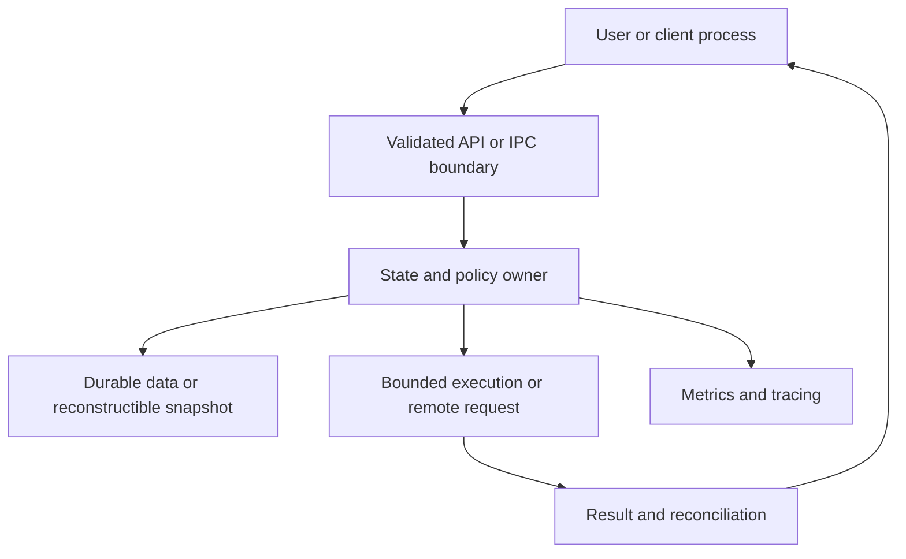
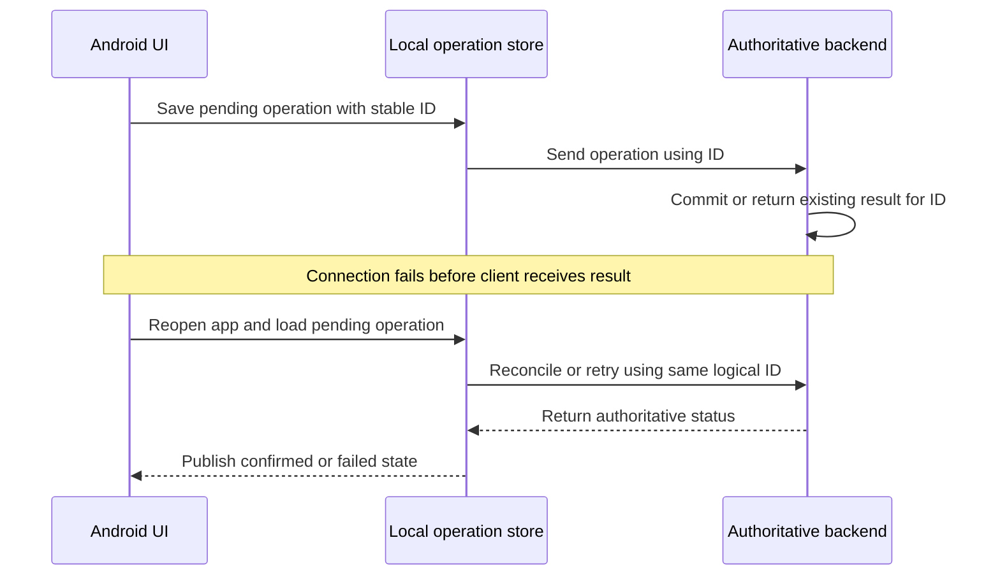
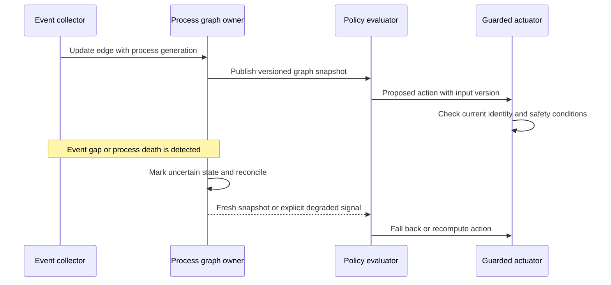

# Android system-design interview template

[Preparation plan](README.md) · [Progress tracker](TRACKER.md)

Use this for a 45-minute practice interview. For an ordinary 25-minute design block, keep the same order but shorten each stage. The goal is a coherent design with defended tradeoffs, not the largest possible architecture diagram.

## Time allocation

| Minutes | Goal | Visible output |
| --- | --- | --- |
| 0–5 | Clarify scope, users, objectives, and exclusions | Three requirements and two explicit non-goals |
| 5–10 | State constraints, contracts, and estimates | Assumptions plus the critical state/API model |
| 10–20 | Design the main architecture and walk one request | One diagram with ownership boundaries |
| 20–32 | Deep-dive into the two most important risks | Sequence/state diagram and a justified alternative |
| 32–40 | Inject failures and define measurement | Recovery path, metrics, tests, and resource limits |
| 40–45 | Summarize tradeoffs and evolution | Migration/rollout strategy and known limitations |

During mocks, reserve the remaining 15 minutes of the one-hour session for feedback. Stop reading notes during the timed 45 minutes.

## 1. Clarify before choosing components

Fill in these statements:

- Users/callers: who initiates the work, and with what trust/permissions?
- Core operation: what must the system do successfully?
- Explicit non-goals: what can be excluded from this interview?
- Correctness: what must never happen, even during retries or failures?
- Latency/throughput/freshness: what is an assumed target, and how will it be measured?
- Device/process constraints: OS/API version assumptions, memory, network, storage, lifecycle, privilege.
- Ownership boundary: what does the client/service own, and what is authoritative elsewhere?

Do not assume a particular employer's expectations or a particular AOSP implementation branch. State the context you are using and ask which dimension the interviewer wants to explore most.

### App-specific questions

- Is offline read supported? Are offline writes allowed or only pending intents?
- What survives rotation, process death, reinstall, account switch, or network loss?
- Is the local database authoritative for display, and which business decisions still require the server?
- Do duplicate actions have a stable request identity?
- What is supported on older app versions or without a dynamic module?

### Platform-specific questions

- Which process and thread own each piece of work?
- Is the call synchronous, asynchronous, reentrant, or cancellable?
- Who validates caller identity/permissions and input bounds?
- What happens when the caller/service dies or a request queue fills?
- Which process-state inputs or dependency edges can become stale?
- How is a policy decision separated from its actuator and its safety fallback?

## 2. Define state, contracts, and budgets

Use only the fields needed to reason about the core case.

| Design | Example fields to discuss |
| --- | --- |
| Pending mobile operation | operationId, accountId, payloadVersion, localState, retry metadata, serverReference |
| Booking/payment view state | local intent, authoritative server status, last reconciliation time; keep booking and payment lifecycles distinct |
| Real-time event | eventId, stream/version, sequence or cursor, entityId, server timestamp, payload version |
| IPC/process graph | process identity, start generation/time, caller/callee identity, edge type, observation timestamp, expiry/reconciliation state |
| Policy decision | input snapshot/version, proposed action, reason, guardrail result, timestamp, rollback mode |
| Performance evidence | scenario/device/build, trace/query identity, measurement window, metric definition, comparison baseline |

**Identity matters:** a PID alone is not a durable process identity; a network response arrival is not proof of what the server committed. Define how observations map to the current logical operation or process generation.

### Estimation drills

Use these as hypothetical arithmetic exercises, not as claims about your past production traffic.

- Assume 100,000 daily active users, 20 requests per active user per day: 2,000,000/day ≈ 23 requests/s average. A chosen 10× peak multiplier gives ≈ 230 requests/s, but needs evidence in a real system. DAU is neither concurrency nor peak load.
- Assume 1,000 telemetry events/s at 64 bytes/event: 64,000 bytes/s, about 230.4 MB/hour before overhead/compression. A 10-second raw buffer needs about 640 KB. Decide what happens when event rate or uploader delay exceeds that budget.
- For rendering, frame budgets depend on refresh rate and pipeline assumptions: 60 Hz is about 16.7 ms per interval, 120 Hz about 8.3 ms. Define the measured jank signal instead of treating one budget as universal.
- For packaged data, separately estimate download/APK payload, expanded disk footprint, extraction peak disk use, first-open latency, and resident/query memory.

Do a few useful calculations; do not spend half the interview estimating quantities that do not change a design decision.

## 3. Draw ownership and one complete flow

Use process boundaries for platform cases and state/data boundaries for app cases. Annotate each arrow with request/event type, sync/async behavior, and failure responsibility.



This is a generic discussion skeleton, not a requirement to make every state durable or to put every operation through a queue. Explain what is persisted, what can be reconstructed, and what may be dropped. Name the owner that prevents duplicate or conflicting work.

### Example app sequence: response lost after server commit



The server must implement the corresponding deduplication/reconciliation contract. A local “sent” flag or a new key on every retry does not solve an ambiguous commit. Do not promise exactly-once completion across all systems merely because one API supports idempotency; a concrete contract can be studied in [Stripe's idempotency documentation](https://docs.stripe.com/api/idempotent_requests).

### Example platform sequence: event loss and stale identity



The interview discussion must define the actual detection/reconciliation mechanism. “Eventually correct” is incomplete without explaining behavior during the uncertainty window.

## 4. Deep-dive with an alternative

For each important choice, use this small decision record:

```text
Decision:
Requirement it satisfies:
Alternative considered:
Why this choice fits the current constraints:
Cost or failure mode introduced:
Evidence or experiment that could reverse the decision:
Migration/rollback path:
```

Examples: bounded queue versus rejecting work immediately; snapshot+events versus events alone; local pending write versus online-only transaction; schema-gated SDUI versus a compiled screen; periodic reconciliation versus event-only process tracking.

Keep thread, lock, callback, and data ownership explicit. “Use coroutines,” “use MVVM,” or “use a message queue” names mechanisms but does not explain ordering, lifetime, correctness, or overload behavior.

## 5. Inject failures

Choose two that stress the highest-risk part of the current case.

| Failure | What the answer must address |
| --- | --- |
| App/process dies | Durable versus lost state, rediscovery, safe recovery |
| Binder peer dies | Outstanding requests, cleanup, reconnection/re-registration, repeated effects |
| Timeout after request send | Unknown outcome, stable identity, status reconciliation, bounded retry |
| Duplicate/out-of-order event | Deduplication identity, ordering scope, sequence gaps, snapshots |
| Queue grows without bound | Admission control, bounded buffers, backpressure, drops/coalescing, priorities |
| Missed/stale graph observation | Generation checks, uncertainty, reconciliation, safe fallback |
| Corrupt or incompatible payload | Validation, version negotiation, last-known-good/fallback, rollback |
| Lock contention/reentrancy | Lock graph, call-out policy, work ownership, measurement |
| Instrumentation changes behavior | Collection overhead, loss counters, controls, sampling bias |
| Performance metric improves but UX worsens | Competing metrics, percentile distribution, causal hypothesis, regression guardrails |

Persistent background work does not imply immediate execution. When timing is important, state what is guaranteed, what depends on Android scheduling constraints, and what the UI/backend does while waiting. [Official persistent-work guidance](https://developer.android.com/develop/background-work/background-tasks/persistent).

## 6. Validate and ship the change

- Functional invariants: what property can be asserted under retries, restarts, or malformed input?
- Measurement: baseline and candidate under comparable workload/device/build conditions; define the metric and units.
- Experiment controls: repeated runs, thermal state, cold/warm distinction where relevant, workload comparability.
- Observability: correlation IDs, events, counters, latency distributions, dropped-event/queue metrics, trace points.
- Rollout: shadow/evaluate-only mode when applicable, limited exposure, stop conditions, feature flag or reversible deployment.
- Operations: who owns the dashboard, the regression decision, and rollback?

For policy/performance changes, name counter-metrics: reducing one CPU counter is not enough if memory, responsiveness, correctness, or user-visible latency regresses. Use [Android performance guidance](https://developer.android.com/topic/performance/overview) and [Perfetto's tracing/analysis documentation](https://perfetto.dev/docs/) to ground the evidence plan.

## Self-scoring rubric

This rubric is a practice tool, not a company's hiring standard. Score after the design, not during it. Maximum: 24.

| Dimension | 1: weak | 2: partial | 3: solid | 4: strong |
| --- | --- | --- | --- | --- |
| Scope and constraints | Starts building without a goal | Some requirements, important ambiguity left open | Clear requirements/non-goals and version/resource assumptions | Prioritizes risks and adapts scope as constraints change |
| Architecture and ownership | Boxes without responsibilities | Main components, unclear boundaries | Clear process/data/thread ownership and an end-to-end flow | Boundaries stay coherent under concurrency and evolution |
| Contracts and data | Vague calls/state | Basic fields but ambiguous identity or authority | Explicit state/API model, authority, identity and lifecycle | Handles compatibility and reconciles conflicting observations |
| Correctness and failures | Only happy path | Names failures without recovery | Concrete recovery for relevant failures and overload | Invariants, degraded behavior and counterexamples are convincing |
| Performance and evidence | Unjustified performance claims | Metrics named without method | Defined budgets, meaningful estimates, comparable measurement | Distinguishes causality, confounders and competing metrics |
| Tradeoffs and rollout | Lists technologies only | One alternative with weak justification | Defends alternatives, migration and rollback | Explains what evidence would change the decision and who owns it |

Personal final-mock target: at least 18/24 on both app and platform, no dimension below 2, and correctness/failures at least 3. A self-score is not independent hiring evidence; whenever possible ask another engineer to challenge the mock design.

## Session note: copy for each practice

```text
Day / date:
Track: App / Platform
Question:
Requirements and non-goals:
Version/resource assumptions:
Main diagram / sequence:
State and identity contract:
Authoritative owner:
Two critical tradeoffs:
Failure 1 and recovery:
Failure 2 and recovery:
Measurement and validation:
Rollout / rollback:
Rubric scores: scope / architecture / contracts / failures / evidence / tradeoffs
What I could not defend:
One next drill:
```

For resume deep dives, add “my contribution,” “team contribution,” “measurement basis,” and “what I cannot independently claim.” The goal is precise, defensible engineering reasoning.
