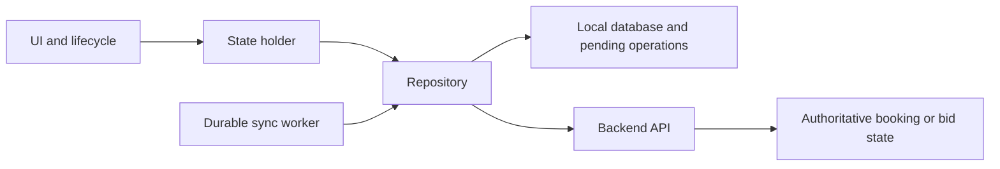
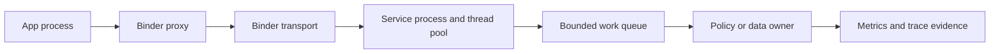

# Four-week system-design preparation: Android App + Android Platform

[Daily tracker](TRACKER.md) · [Interview/design template](DESIGN_TEMPLATE.md) · [DSA roadmap](../dsa-patterns/README.md)

## Your target and constraints

- Target both **Senior/Lead Android application engineering** and **Android framework/AOSP platform engineering**, with equal preparation time.
- Budget: **4 weeks × 7 sessions × 60 minutes = 28 hours**: 14 app sessions and 14 platform sessions.
- Day numbers are relative to when you start; no calendar schedule or reminders are assumed.
- This is interview preparation and explanation practice. Build small interface/state sketches, not a production app or a new kernel subsystem in four weeks.
- The target is inferred from your resume and confirmed preference, not a particular employer's interview rubric. If a job description arrives, tune the remaining mock prompts to its requirements.

## Why this plan matches your resume

The source is your locally supplied resume, reviewed on 10 November 2026. The original PDF remains local and is not part of these published study materials. Its achievements are self-reported; this plan does not independently verify the performance claims. Contact details are deliberately not repeated here.

| Resume experience | Design story to prepare | Questions to be ready for |
| --- | --- | --- |
| Samsung process prioritization and dependency-aware oom adjustment | State/dependency policy under memory pressure | How are identities, stale edges, competing objectives, and rollback handled? |
| Real-time IPC topology graph | Event collection and graph maintenance | What constitutes an edge, how long does it live, and how do you recover from loss/PID reuse? |
| Perfetto/eBPF and performance improvements | Evidence-led diagnosis and low-overhead observability | Which signal distinguishes CPU work from waiting, and what is collection overhead? |
| LLM-assisted Perfetto analysis | Developer-tool pipeline and evaluation | How is every conclusion tied to evidence, and when should the tool abstain? |
| RedRail booking funnel | End-to-end mobile transaction flow | Where is authoritative state, and what survives client death or an ambiguous timeout? |
| Compressed offline train data | Offline read path and asset/database lifecycle | What changes in APK, installed size, first-open cost, disk use, and memory? |
| Modular/dynamic feature delivery and Compose | Large-app boundaries and performance | How do older clients, missing modules, and staged migrations work? |
| Real-time auction and SDUI | Event correctness and versioned rendering | What happens after a missed event, duplicate bid, or incompatible component? |

Your preparation advantage is connecting **app behavior → framework/process boundaries → performance evidence**. Treat leadership as part of every answer: ownership, alternatives, migration, regression monitoring, and reversible rollout.

## What to prioritize

| Area | Depth in these four weeks |
| --- | --- |
| Android app architecture | State ownership, local data, lifecycle, sync, modularity, SDUI, real-time behavior |
| Android platform architecture | Process/service boundaries, Binder/AIDL, concurrency, identity, memory-pressure policy, tracing |
| Reliability | Timeouts, duplicate work, ordering, backpressure, process death, stale state, recovery |
| Measurement | Latency distributions, jank definition, CPU work versus time, memory, power-related evidence, overhead |
| Backend concepts used by mobile | API contracts, idempotency, authoritative transactions, queues, cache freshness, observability |
| Lead-level communication | Explain rejected alternatives, ship incrementally, define ownership, validate and roll back |

Generic distributed-system knowledge is included where it supports a case. Large-scale storage internals, exchange matching engines, maps routing, and a full payment ledger are lower priority for this 28-hour plan. Backend-only roles would need a different allocation.

## The one-hour routine

**Ordinary session:** 5 minutes recall → 15 minutes targeted reading → 25 minutes design from a blank page → 10 minutes failure/tradeoff challenge → 5 minutes score and note one gap. Stop at 60 minutes.

**Mock session:** 45 minutes closed-notes design using the [interview template](DESIGN_TEMPLATE.md) → 15 minutes scoring and feedback. On a mock day, do not add extra reading or a second design.

Keep the output to one main diagram, one short sequence/state sketch when needed, and a few bullets. A complete design argument matters more than drawing many boxes. Use Kotlin/Java for app interface sketches; AIDL/C++ boundaries or language-neutral pseudocode are appropriate for platform discussions.

## Four-week schedule

Resource codes refer to the reading list later in this document. Read only the relevant subsection in the 15-minute reading budget, not an entire chapter. All deliverables below are planned tasks, not completed work.

### Week 1: Foundations and a baseline

| Day | Track | Session / question | Reading | Concrete deliverable |
| --- | --- | --- | --- | --- |
| 01 | App | **Baseline: design the RedRail booking funnel** Identify user journeys, component boundaries, authoritative booking state, and two failure cases. | A, H1 | One baseline diagram, five assumptions, and an initial self-score. |
| 02 | Platform | **Android execution and process lifecycle** Draw app process, framework services, Binder, and kernel boundaries; trace a launch and one process death. | B | One interaction sequence with thread/process ownership. |
| 03 | App | **Offline-first railway data and synchronization** Choose local source of truth, repository contract, freshness, retries, and pending-write representation. | O | Read/write sequences plus a small local schema. |
| 04 | Platform | **Binder/AIDL service design** Define a service contract, call direction, thread ownership, permissions, death handling, and versioning questions. | B, I | Interface sketch and normal/dead-peer sequences. |
| 05 | App | **Versioned server-driven UI** Design a component schema and renderer registry; handle unknown types, incompatible versions, and bad payloads. | A, S | Schema example, fallback policy, and rollout decision. |
| 06 | Platform | **Performance investigation as a design process** Separate CPU work, waiting, locks, scheduling, and rendering; choose traces and a controlled comparison. | P, T | Hypothesis-to-evidence table with one counter-hypothesis. |
| 07 | App | **Mock 1: booking funnel with process death** 45-minute design: payment result arrives after the app dies; finish with a recovery/rollback explanation. | None: closed notes | Timed mock score and top two gaps. |

### Week 2: State, correctness, and ownership

| Day | Track | Session / question | Reading | Concrete deliverable |
| --- | --- | --- | --- | --- |
| 08 | Platform | **Process importance and memory pressure** Design a hypothetical prioritization policy using state/dependency inputs; discuss protected work, hysteresis, and stale edges. | L | Policy decision table, two counterexamples, and safety fallback. |
| 09 | App | **Real-time auction client** Define snapshot/event contract, bid acknowledgment, reconnect, ordering, duplicate handling, and stale UI behavior. | A, H2 | Event schema and reconnect sequence with cursor/gap recovery. |
| 10 | Platform | **Live IPC topology graph** Model process identities and edges; handle PID reuse, missed events, process death, reconciliation, and bounded overhead. | B, T | Graph schema, update pipeline, and loss/rebuild policy. |
| 11 | App | **Booking/payment consistency** Separate client intent from server authority; define booking/payment states, durable request IDs, retry and reconciliation. | Q, H3 | State machine covering timeout, duplicate retry, and late success. |
| 12 | Platform | **Device telemetry collection pipeline** Set a collection budget; choose buffers, sampling, batching, persistence, upload, backpressure, and data retention. | T, H4 | Data-flow diagram and explicit loss/retention decisions. |
| 13 | App | **Modular Android app and dynamic feature delivery** Choose module boundaries, dependency direction, navigation contracts, optional feature availability, and staged migration. | M | Module graph and plan for feature download failure. |
| 14 | Platform | **Mock 2: dependency-aware process policy** 45-minute design: memory pressure coincides with foreground work and a stale dependency graph. | None: closed notes | Timed mock score and evidence for policy guardrails. |

### Week 3: Reliability, measurement, and evolution

| Day | Track | Session / question | Reading | Concrete deliverable |
| --- | --- | --- | --- | --- |
| 15 | App | **Offline asset delivery and database migration** Revisit the packaged database: download/install/decompress costs, checksums, atomic replacement, schema upgrades, and rollback. | O | Lifecycle diagram and interrupted-update recovery steps. |
| 16 | Platform | **Startup and Compose jank investigation** Separate cold/warm startup, device conditions, main-thread work, Binder waits, and rendering; choose comparable measurements. | P, C, T | Experiment matrix with metrics, controls, and regression checks. |
| 17 | App | **Notifications, background sync, and process recreation** Separate user-visible events from durable sync work; define lifecycle, deduplication, retry, and stale/deep-link handling. | W, H5 | Background-work decision table and reopen-after-death sequence. |
| 18 | Platform | **LLM-assisted Perfetto analysis tool** Design trace ingestion, deterministic queries, evidence-grounded explanations, evaluation, privacy boundaries, and bounded tool execution. | T | Pipeline, evaluation rubric, and behavior on unsupported conclusions. |
| 19 | App | **SDUI incident response and architecture evolution** Handle a bad server rollout on older clients; plan compatibility checks, kill switch, caching, fallback, and recovery. | S, M | One incident timeline plus a staged rollback plan. |
| 20 | Platform | **Reliable privileged service under overload** Design bounded request handling and cancellation; discuss reentrancy, locks, caller permissions, priority, and client death. | B, I, S | AIDL-level contract, thread/lock diagram, and overload policy. |
| 21 | App | **Mock 3: real-time auction with reconnect and duplicate bids** 45-minute design; inject an event gap and an ambiguous bid timeout, then defend server/client ownership. | None: closed notes | Timed mock score and comparison with Mock 1. |

### Week 4: Resume defense and interview readiness

| Day | Track | Session / question | Reading | Concrete deliverable |
| --- | --- | --- | --- | --- |
| 22 | Platform | **Mock 4: fleet performance monitoring** 45-minute design: collection overhead rises, buffers overflow, and uploads fail during a rollout. | None: closed notes | Timed mock score, data-loss budget, and rollback trigger. |
| 23 | App | **Resume defense: RedRail/offline/SDUI** Practice two app stories: what you owned, alternatives rejected, evidence, migration, and an incident or limitation. | Your own project recollection | Two five-minute story outlines; mark facts still needing verification. |
| 24 | Platform | **Resume defense: process policy/performance/IPC graph** Defend one performance result and one platform design; distinguish measurements, causal claims, and team contribution. | Your own project recollection | Two five-minute story outlines plus benchmark methodology. |
| 25 | App | **Repair weakest app design and change one constraint** Re-solve the weakest case from a blank page; add poor connectivity, smaller storage, or an older supported client. | A previous mock gap | Revised design and one explicit tradeoff reversal. |
| 26 | Platform | **Repair weakest platform design and inject failure** Re-solve the weakest case; inject dead Binder peer, reentrant call, CPU contention, or stale process identity. | A previous mock gap | Failure sequence and a quantitative verification plan. |
| 27 | App | **Mock 5: offline-first travel app with booking recovery** Final 45-minute app mock: cache freshness, authority, interrupted payment, rollout and observability. | None: closed notes | Final app score and remaining interview-day reminders. |
| 28 | Platform | **Mock 6: IPC graph feeding a safe process policy** Final 45-minute platform mock: identity, graph freshness, bounded overhead, safety, validation and rollback. | None: closed notes | Final platform score and remaining interview-day reminders. |

## Two different design lenses

### App lens: device state and server authority

This is a practice starting point, not a mandated architecture. Decide which reads are local, which operations require server confirmation, and which user-visible state is merely pending. A completed local database write cannot by itself prove a successful booking/payment.

### Platform lens: ownership, latency, and failure boundaries

Label synchronous versus asynchronous calls, execution threads, permission checks, callback/death behavior, lock ownership, and queue capacity. Do not assume that changing an asynchronous interface removes every source of waiting or backpressure.

## Resume deep-dive evidence checklist

These are questions to resolve from your own evidence, not suggested replacement claims.

| Claim/story | Clarify before using it in an interview |
| --- | --- |
| 50 billion fewer CPU instructions/day | Device/workload basis, sampling/extrapolation, baseline, attribution, and repeatability. Instruction count alone is not measured battery energy. |
| 42% decrease in application jank | Relative decrease versus percentage-point change, exact jank metric/denominator, scenarios, device/software versions, and distribution. |
| 20 ms cold-start improvement / 30% Compose jank reduction | Startup boundaries, cold versus warm conditions, percentiles, thermal conditions, iterations, and regression controls. |
| 130 MB compressed to 8 MB | Packaged payload versus expanded database/installed storage, first-open/decompression cost, query performance, corruption and upgrade behavior. |
| 1M+ monthly registered users / 100K+ DAU | Distinguish registrations, active users, concurrency, API traffic, and the work you personally owned. Do not infer peak QPS from these labels alone. |
| 20% faster root-cause analysis with an LLM tool | Definition of investigation time, evaluation sample, baseline workflow, correctness, reviewer effort, and unsupported conclusions. |
| Leadership and reviews | One consequential design decision, mentoring impact, coordination boundary, a disagreement, and what you would change now. |

Prepare four short narratives: app architecture, offline data, process/IPC policy, and performance diagnosis. For each: context → constraint → your decision → rejected alternative → outcome → evidence/limitation. Explain only details you can substantiate and distinguish your work from the team's work.

## Case bank and escalating follow-ups

| Case | First design question | Follow-up that tests depth |
| --- | --- | --- |
| Booking funnel | Search, booking intent, payment, confirmation, recovery | Response is lost after server commit; the user retries on another device. |
| Offline train data | Asset install, local queries, refresh, migration | Download/decompression is interrupted while old data remains in use. |
| Real-time auction | Snapshot plus live updates and bid state | Event cursor has a gap and a bid acknowledgment is delayed. |
| SDUI | Versioned schema, component registry, compatibility | Server emits an unsupported component during a staged rollout. |
| Dynamic modules | Ownership, dependency graph, optional delivery | User enters a deep link before the module is installed. |
| Background synchronization | Persistent intent, work deduplication, retries | Process dies after request send but before local acknowledgment. |
| IPC graph | Process identity, edges, reconciliation, queries | PID is reused and events are dropped while collecting. |
| Process policy | Importance inputs, dependencies, actuation, guardrails | Stale dependency information conflicts with critical foreground work. |
| Privileged service | AIDL boundary, queue/locks, permissions, cancellation | Caller dies or re-enters while the service is overloaded. |
| Performance monitoring | Signals, buffers, aggregation, regressions | Collection itself changes CPU/power behavior or drops evidence. |
| Startup/jank investigation | Establish measurements and competing hypotheses | CPU counters improve but user-visible p95 latency regresses. |
| Trace-analysis agent | Deterministic extraction, evidence, explanations, evaluation | A convincing answer cannot be backed by an observed trace event. |

## Official resources: use as targeted references

These sources were opened/checked on 10 November 2026. The schedule is my preparation recommendation, not an official Android interview syllabus. Android/platform details depend on OS branch and target API; state the version assumptions rather than memorizing a universal behavior.

| Code | Resource | Focus for this plan |
| --- | --- | --- |
| A | [Guide to app architecture](https://developer.android.com/topic/architecture) | Ownership, layers, and boundaries to justify in an app design |
| O | [Offline-first data layer](https://developer.android.com/topic/architecture/data-layer/offline-first) | Local reads, network coordination, synchronization |
| M | [App modularization](https://developer.android.com/topic/modularization) | Module boundaries and dependency direction |
| C | [Compose performance](https://developer.android.com/develop/ui/compose/performance) | Measurement and rendering-specific deep dives |
| W | [Persistent background work](https://developer.android.com/develop/background-work/background-tasks/persistent) | WorkManager scope, persistence, constraints, and limitations |
| P | [App performance overview](https://developer.android.com/topic/performance/overview) | Frame the metrics and diagnosis plan |
| B | [AOSP Binder overview](https://source.android.com/docs/core/architecture/ipc/binder-overview) | IPC boundaries and transport model |
| I | [AIDL overview](https://source.android.com/docs/core/architecture/aidl) | Cross-process contracts and generated bindings |
| L | [Low memory killer daemon](https://source.android.com/docs/core/perf/lmkd) | Memory-pressure behavior; distinguish policy inputs from kill decisions |
| T | [Perfetto documentation](https://perfetto.dev/docs/) | Recording, analysis, and tracing-based evidence |
| S | [Android security checklist](https://developer.android.com/privacy-and-security/security-tips) | Permission, storage, and IPC trust boundaries |
| Q | [Idempotent requests: Stripe API example](https://docs.stripe.com/api/idempotent_requests) | A concrete retry contract, not proof of exactly-once end-to-end payment completion |

Use architecture guidance to inform tradeoffs, not to replace the explanation with library names. WorkManager is a durable-work tool, not a general guarantee of immediate execution; check its current constraints when a scenario depends on timing.

## Material already in this folder

Your HLD collection is a useful secondary reference. Its cases complement but do not replace Android-specific design practice. The titles below are linked as existing study material; the daily time budget permits selected sections only.

| Code | Local reference | Why it is included |
| --- | --- | --- |
| H1 | [Interview framework](hld/04_Framework_for_Sys_Design_Interviews.pdf) | Structure and requirement clarification |
| H2 | [Chat system](hld/13_Design_a_chat_system.pdf) | Adapt real-time reconnect/ordering ideas to an auction client |
| H3 | [Payment system](hld/27_payment_system.pdf) | Backend authority and transaction/recovery boundaries |
| H4 | [Metrics monitoring and alerting](hld/21_Metrics_Monitoring_and_Alerting_System.pdf) | Device telemetry and regression-detection discussion |
| H5 | [Notification system](hld/11_Design_Notification_System.pdf) | Delivery and deduplication questions at the app/backend boundary |
| Optional | [Scale from zero to millions](hld/02_Scale_From_0_to_millions.pdf) | Brief load/caching vocabulary only if a mock exposes a gap |
| Optional | [Distributed message queue](hld/20_Distributed_Message_Queue.pdf) | Backpressure, delivery, and replay vocabulary for relevant cases |
| Optional | [Rate limiter](hld/05_Design_a_rate_limiter.pdf) | Admission/overload reasoning, not a required extra case |

## First session: start here

**Prompt:** “Design the Android client architecture for a rail booking application with cached search results, unreliable connectivity, payment, and recovery after process death.”

For today's 60 minutes: spend 5 recalling a real user journey, 15 reading the architecture/reference framework, 25 drawing a baseline from memory, 10 injecting “payment succeeded but response was lost,” and 5 recording your initial score.

Produce five things: a stated scope, one architecture diagram, the authoritative booking state, the pending-operation recovery path, and two tradeoffs. This is your baseline; do not mark yourself interview-ready after one good diagram.

## Progress and exit criteria

Use [the tracker](TRACKER.md) and [the scoring rubric](DESIGN_TEMPLATE.md#self-scoring-rubric). Six mocks are scheduled, three per track; the remaining 22 sessions build and refine the underlying skills.

A useful personal readiness target is at least 18/24 on each of the final app/platform mocks, no dimension below 2, and at least 3 on correctness/failure handling. This is a self-assessment target, not an employer pass threshold. If you miss it, use the gaps to prioritize the next week's sessions rather than claiming readiness.

If you miss a day, shift the remaining day numbers. Keep the 60-minute limit; preserve final app and platform mocks and trim optional reading first. DSA practice is a separate budget, not silently included in these 28 hours.
